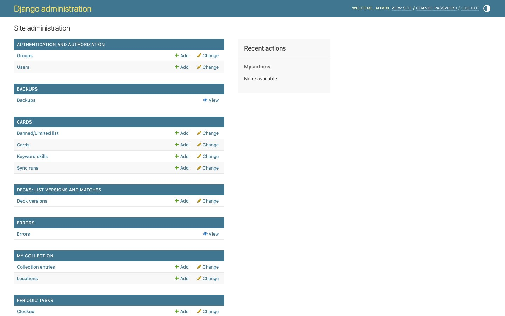
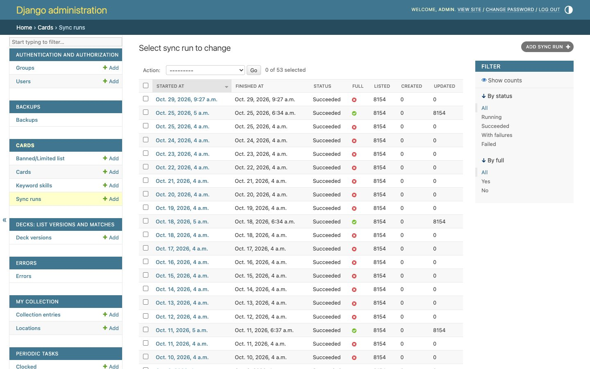

# El admin de Django

El **admin** (`/admin/`) es el panel de administración de Django. Desde la web normal no se puede hacer nada de esto: revisar precios, ver los errores, lanzar copias de seguridad o consultar los datos en crudo.

## Entrar

- **En el servidor:** `http://192.168.1.50/admin/` (también vale el puerto 5173) con el usuario `admin`.
- **En local:** `http://localhost:8000/admin/` con **admin / admin**, que se crea solo en la primera instalación. Para crear otro usuario, usa `make superuser`.

El admin está en español y usa la hora de Madrid.

> [!TIP]
> Puedes tener el admin y la web abiertos a la vez en el mismo navegador: la web manda el token de seguridad (CSRF) que Django pide cuando hay una sesión iniciada.

## Secciones

| Sección | Qué contiene | Para qué la usarás |
|---|---|---|
| **Cartas** | Cartas, historial de sincronizaciones («sync runs»), **Lista Banned/Limited** y keyword skills | Consultar una carta en crudo; ver si el último sync fue bien. |
| **Mi colección** | Ubicaciones y filas de colección (carta + ubicación + cantidad + falsa) | Consultas puntuales. Para el día a día usa la web. |
| **Mazos: versiones de lista y partidas** | Versiones de cada mazo con sus partidas | Consultas puntuales. |
| **Escáner** | Escaneos, sesiones y huellas de las cartas | Revisar un escaneo concreto. |
| **Errores** | Los fallos de la web, el servidor y las tareas | Ver [Registro de errores](registro-de-errores.md). |
| **Copias de seguridad** | Estado de las copias, hacer una ahora y descargarlas | Ver [Copias de seguridad](copias-de-seguridad.md). |
| **Precios (Cardmarket)** | Expansiones, productos, enlaces, precios, historial, cambio dólar/euro y **revisar emparejamientos** | Ver [Revisar precios](revisar-precios.md). |
| **Periodic tasks** | Las tareas programadas | Consultar horarios. Ver el aviso de abajo. |
| **Autenticación** | Usuarios y grupos | Crear o cambiar usuarios del admin. |

## Historial de sincronizaciones

En *Cartas → sync runs* está cada sincronización con Bandai:
- cuándo empezó y terminó;
- si era **completa**;
- cuántas cartas listó, creó y actualizó;
- su estado: **En curso**, **Correcto**, **Con fallos** (algunas cartas no se pudieron descargar) o **Error**.

Si una sincronización falla, también llega un aviso por Telegram (ver [Tareas programadas y avisos](tareas-programadas.md)).

## Tareas programadas (Periodic tasks)

En *Periodic tasks* se ven las tareas automáticas y su horario.

> [!IMPORTANT]
> Los cambios que hagas aquí **no duran**: al reiniciar el servicio de tareas (pasa en cada despliegue), los horarios se vuelven a cargar desde el código (`backend/config/settings.py`). Para cambiar un horario de verdad hay que tocar el código.

La lista completa está en [Tareas programadas y avisos](tareas-programadas.md).
