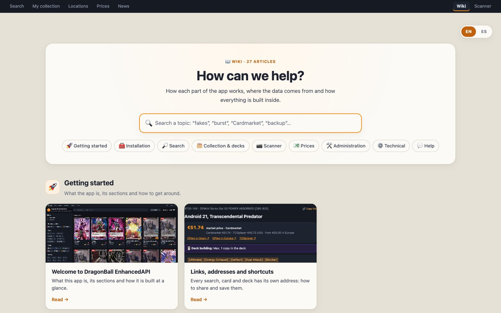

# DragonBall EnhancedAPI wiki

User guide and technical documentation. These same articles are shown on the site at **`/wiki`** (for example `http://192.168.1.50/wiki`), with search and zoomable screenshots.

## 🚀 Getting started
- [Welcome to DragonBall EnhancedAPI](bienvenida.md): what the site is, its sections and how it's put together.
- [Links, addresses and shortcuts](enlaces-y-navegacion.md): sharing cards and searches, and the keyboard shortcuts.

## 🧰 Installation
- [Step-by-step installation](instalacion.md): with Docker, on your computer or on the server.
- [What must be running](servicios.md): containers, tasks, systemd and the optional bits outside the server, and how to check them.

## 🔎 Search
- [Searching cards](buscar-cartas.md): text search, filter panel, sorting and pagination.
- [Advanced mode](modo-avanzado.md): conditions with AND / OR / NOT.
- [Card details](ficha-de-carta.md): text, printings, price, errata, Q&A and your copies.
- [News](novedades.md): catalogue changes since your last visit.

## 🗂️ Collection & decks
- [My collection](mi-coleccion.md): copies, locations, fakes and value.
- [Locations](ubicaciones.md): decks, binders and boxes.
- [Decks](mazos.md): Leader, versions, side deck, matches, stats and archive.
- [Import, export and collection backup](importar-exportar.md): CSV and JSON.

## 📷 Scanner
- [Using the scanner](escaner.md): phone, HTTPS, burst mode and binder mode.
- [Reviewing uncertain scans](revisar-escaneos.md): confirming and fixing.
- [How cards are recognized](como-reconoce.md): fingerprints, thresholds and photos.

## 💶 Prices
- [Where each price comes from](precios.md): Cardmarket, TCGplayer and prices set by hand.
- [The Prices page](pagina-precios.md): collection value, the ones going up and the ones going down.
- [Reviewing prices in the admin](revisar-precios.md): matching, fixing and setting prices by hand.

## 🛠️ Administration
- [The Django admin](admin.md): what's in `/admin/`.
- [Error log](registro-de-errores.md): failures recorded and reported via Telegram.
- [Backups](copias-de-seguridad.md): daily, on demand, retention and restore.

## ⚙️ Technical
- [Architecture](arquitectura.md): services, servers and configuration.
- [Data and syncing](datos-y-sincronizacion.md): Bandai, the official site, images and own printings.
- [Scheduled tasks and alerts](tareas-programadas.md): schedules, health and Telegram.
- [Development and deployment](despliegue.md): local setup, tests, CI and deploying to the server.
- [REST API](api.md): every endpoint.

## 💬 Help
- [FAQ and troubleshooting](preguntas-frecuentes.md)

---

**To edit the wiki** go to [Development and deployment → Writing in the wiki](despliegue.md#writing-in-the-wiki). Screenshots are regenerated with `python scripts/wiki_screenshots.py`.
