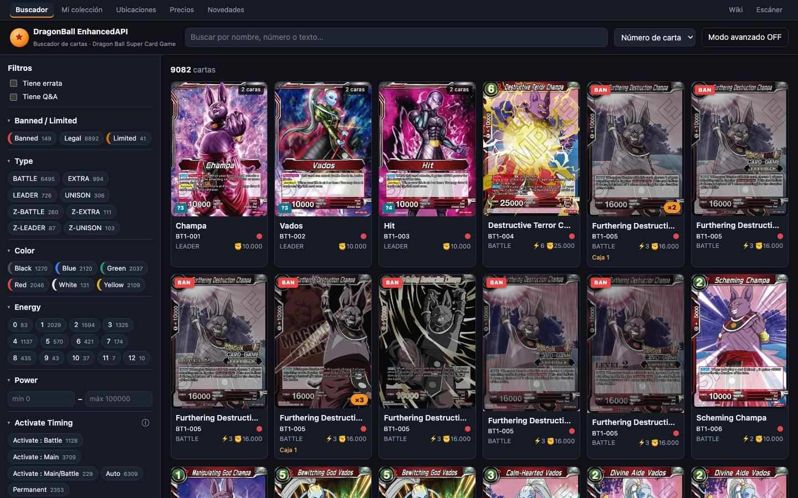
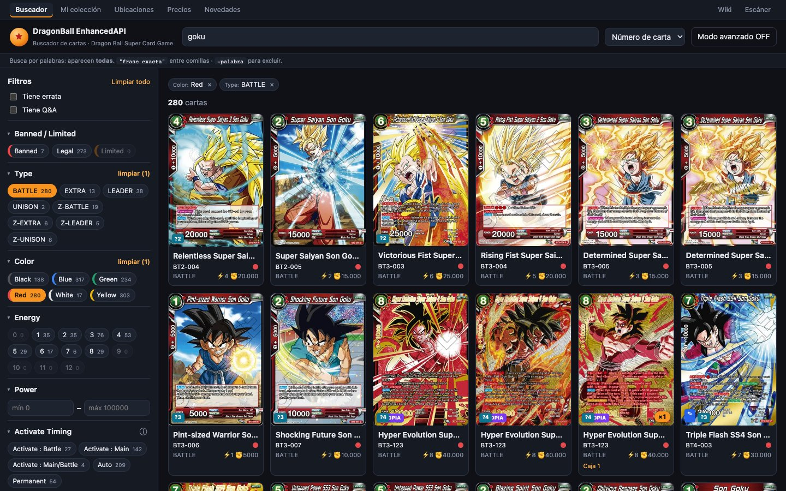
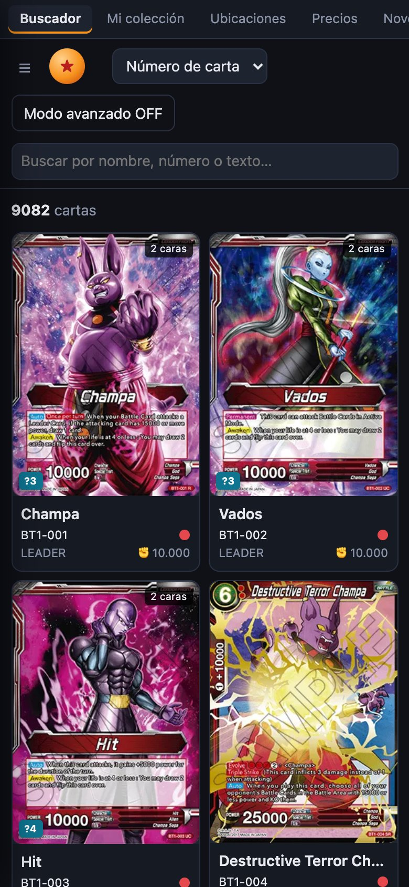

# Searching for cards

**Search** (`/`) is the main page. It has the whole Dragon Ball Super Card Game (Masters) catalogue, with over 9,000 printings. From here you search by text, filter with the sidebar, sort, and open any card's page.

## The header

| Element | What it does |
|---|---|
| **★ DragonBall EnhancedAPI** | Goes back to the starting state. Clears the text, the filters and the advanced tree, sets **Advanced mode** to OFF, the order to **Card number** and the page to 1. It also closes any open card page and scrolls to the top. |
| **☰** | Opens the filters panel. Only shown on narrow screens (phone or tablet, up to 900 px). |
| **Search box** | Free-text search (see below). |
| **Sort selector** | Changes the order of the results. |
| **Advanced mode OFF / ON** | Shows or hides the advanced search builder. See [Advanced mode](modo-avanzado.md). |

## Text search

The box searches the **name** (including the back side of Leaders), the **card number** and the **text** of both sides at once.

- **Several words: all of them must appear** (AND), in any order. `goku barrier` returns cards that have “goku” and also “barrier”.
- **Parts of words work**: it isn't case-sensitive, so `gok` already finds Goku.
- **`"exact phrase"` in quotes**: the words must appear together and in that order. `"draw 1 card"`.
- **`-word` to exclude**: removes cards that contain it. It works with phrases too: `-"Super Combo"`.
- **Brackets and spaces don't matter**: `it gains Barrier` finds “it gains **[Barrier]**”, and `activate:main` finds “[Activate : Main]”.
- **It only searches once you stop typing** (150 ms later) and goes back to page 1.
- **200 characters max.** If you go over, an error appears in red next to the counter.

> [!TIP]
> While you type, a syntax reminder appears under the box: “Searches by words: **all** must appear. `"exact phrase"` in quotes · `-word` to exclude.”

> [!NOTE]
> Free text has no **OR**. For “one thing or another”, use the values in the sidebar (within the same field they combine with OR) or [Advanced mode](modo-avanzado.md).

## The filters panel

On the left is the **Filters** panel. Each section is a card field, and each value shows **how many cards** match it.

### The sections

At the very top there are two checkboxes: **Has errata** and **Has Q&A**. Below them, in this order (field names are in English, as on the cards):

| Section | How you choose | Open by default |
|---|---|---|
| **Banned / Limited** | Buttons: Banned, Limited, Legal | Yes |
| **Type** | Buttons: BATTLE, LEADER, EXTRA, UNISON, Z-BATTLE… | Yes |
| **Color** | Buttons with the colour | Yes |
| **Energy** | Buttons by cost | Yes |
| **Power** | Range min – max | Yes |
| **Activate Timing** | Buttons with their official explanation | Yes |
| **Keyword Skills** | List with explanation and variants | Yes |
| **Keywords** | List with explanation and variants | Yes |
| **Special Trait** | List | No |
| **Character** | List | No |
| **Rarity** | List | No |
| **Era** | List | No |
| **Series** | Buttons, and below them the sets in each series | No |
| **Color Cost** | Buttons | No |
| **Combo Energy** · **Combo Power** · **Z-Energy Cost** | Buttons | No |
| **Power (Back Side)** | Range min – max | No |

A closed section opens by itself if something in it is ticked. When a section is active, its header shows **clear (N)** to remove everything ticked in it.

### How values combine

- **Within the same field, the default is OR**: with Red and Blue ticked you get red cards *or* blue cards.
- **In list fields** (Color, Activate Timing, Keyword Skills, Keywords, Special Trait, Character, Era and Color Cost), when you tick two or more values the **Any (OR)** / **All (AND)** selector appears. With **All (AND)** and Red + Blue you only get cards that are red **and** blue at the same time.
- **Different fields always combine with AND**: Color Red **and** Type BATTLE.
- **In ranges** (Power) you can fill in just the minimum or just the maximum.

### The counts

Each number says how many cards you'd get **within your current search**. A handy detail: each field is counted *without its own filter*. So with “Color: Red” ticked you still see how many Blue, Green… there are, and you can widen the selection knowing what you'll add. Values with 0 cards are dimmed, but you can still tick them.

### Long lists

If a section has more than 10 values:
- A **Search N…** box appears at the top to filter the list.
- Only the first 10 and the ones you've ticked are shown. **Show all (N)** expands the rest and **Show less** collapses it.

### Keyword skills and their variants

In **Activate Timing**, **Keyword Skills** and **Keywords**:
- Hovering over a value shows its **official explanation**, the one from Bandai's rules page.
- If a skill is newer than that page, the tooltip says “Not listed on the official keyword skills page (it's newer than its last update).”
- The **ⓘ** icon opens the official keyword skills page.
- Skills with a number (**Over Realm X**, **Burst X**, **Limit X**…) have a small button to **Pick specific values** (Over Realm 3, 4, 5…). Those values always combine with OR.

### Series and sets

When you tick a series (for example **BT**), its sets appear below: “BT · N sets” (BT1, BT2…). That way you can narrow it down to one or several specific sets. Unnumbered series (P, XD…) don't have this second row. Unticking the series also removes its sets.

### Active filters and “Clear all”

- **Tags above the results:** each sidebar filter appears as a “Field: value ×” tag. The **×** removes that value. Ranges show as “Power: 10000 – …”.
- **Clear all** (at the top of the panel) appears when something is active. It clears the text, the filters and the advanced conditions. It doesn't turn off Advanced mode or change the order.

### On mobile

On narrow screens the panel is hidden: open it with **☰**. It closes:
- with the **Show N cards** button at the bottom, which also tells you how many cards you'll get;
- by tapping outside the panel;
- or with <kbd>Esc</kbd>.

## Sorting

| Option | Order |
|---|---|
| **Card number** (default) | Series → set number → collector number (BT1-001, BT1-002… BT2-001…) |
| **Oldest** / **Newest** | By the order in which Bandai added each card |
| **Name A-Z** | Alphabetical |
| **Energy ↑ / ↓** | By cost |
| **Power ↑ / ↓** | By power |

Cards without that value (for example, Power on an EXTRA) always go at the end.

## The results

- **Counter:** above the grid, “**N** cards”.
- **48 cards per page.**
- **No results:** “No cards match these filters.”

Each card in the grid shows:

- **The image.** If it doesn't load, the card number is shown instead.
- **Deck-building badges:**
  - **1 COPY**: Ultimate, 1 max in the deck.
  - **SC ≤4**: 4 [Super Combo] cards max.
  - **DB ≤7**: 7 [Dragon Ball] cards max.
- **2 sides** on double-sided cards.
- **×N** if you have genuine copies of that card.
- **BAN** or **LIMIT 1** if it's on the ban list. Banned cards are greyed out. Hover to see since when.
- **✎** if it has an official erratum, and **?N** if it has N official questions (Q&A).
- **Below the image:**
  - name, number and colour dots;
  - type, ⚡ Energy and ✊ Power;
  - the locations where you have copies.

Click a card to open [its page](ficha-de-carta.md).

### Pages

At the bottom are **← Previous** and **Next →** (on mobile, ‹ and ›). The first and last pages are always shown, plus the two on each side of the current one; gaps are marked with “…”. When you change page, the view scrolls back to the top by itself.

## Filtering from a card

On a card's page you can click on:
- any **[skill in brackets]** in the text, then **Filter cards with [skill] →** in the box with its explanation;
- the **Type**, **Character**, **Special trait** or **Era** tiles.

That value is **added** to the filters and the card page closes. It's the fastest way to search for “more cards with [Barrier]” or “more Saiyans”.

> [!TIP]
> Text in brackets is translated to the official name: `[Over Realm 3]` filters by the “Over Realm X” skill.

## The address keeps the search

Everything you choose is reflected in the browser's address: text, filters, order, page and advanced mode. If you copy the address and open it somewhere else, you get the same search. We explain it in [Links, addresses and shortcuts](enlaces-y-navegacion.md).
