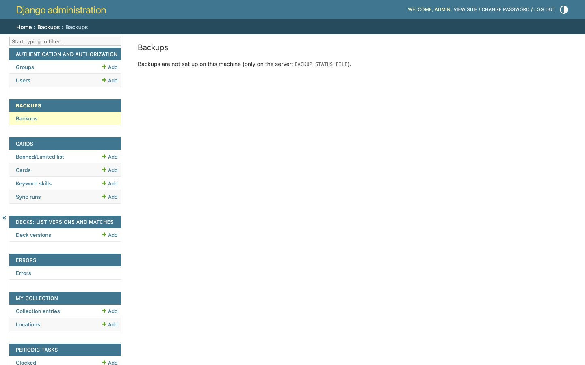

# Backups

All the data (catalog, collection, decks, matches, prices, scans…) lives in the server's database. **A backup is made every night** automatically and, if you set it up, it's also taken off the server (another machine, the cloud or a VPS). From the admin you can see its status, make a backup right away and download it.



## The admin page

In the admin: **Backups** (`/admin/backups/backup/`).

### Status

At the top you can see how the last backup went:
- **⏳ Backup in progress**: it usually takes about 15 minutes;
- **⏳ Backup requested**: it will start in a few seconds;
- **✅ Last backup succeeded**;
- **❌ The last backup failed**, with the error message: which step failed, which command and its last lines;
- **No backups yet**.

Below that, the **Off-server copy:** line says whether the last external copy went well (**✅ copied**), failed (**❌ failed**) or is **not configured**.

While a backup is in progress, the page refreshes by itself every 15 seconds.

### Back up now

The **Back up now** button launches a backup right away. The message says “Backup requested: it will start in a few seconds and takes about 15 minutes.”

> [!TIP]
> Make a backup by hand **before big changes**: importing a large CSV, reorganizing locations or deploying a version with database changes.

### Downloading

Backups are grouped into **Daily**, **Weekly** and **Other** folders, with their date. You can download the database `.dump` files.

## What gets backed up

| What | How |
|---|---|
| **Database** | `pg_dump` in compressed format (`.dump`), and it's checked that it can be read. |
| **Files** (`media` volume) | A `.tgz` with the images of the [own printings](datos-y-sincronizacion.md#own-printings). It's checked that the `.tgz` can be opened. |
| **Not backed up** | Scan photos (they're deleted after 24 h anyway), Redis, or the official image cache (it gets downloaded again). |

## When and how many

- **Daily:** at **03:30**. It's launched by a systemd timer on the server, outside Docker. If the machine was off at that time, the backup runs when it's turned on.
- **Weekly:** on **Sundays** the day's backup is also kept as the weekly one.
- **Retention:** **7 daily** and **4 weekly** backups are kept; older ones are deleted automatically.
- **Off-server copy (optional):** after each backup, everything can also be taken:
  - to **another machine at home** or to a **VPS**, via rsync (`BACKUP_REMOTE`);
  - to **the cloud** with rclone (`BACKUP_RCLONE`): Backblaze B2, Google Drive, Dropbox, S3…

  If it fails, the local backup is still valid and the failure is recorded. How to set it up: [Installation → Extras](instalacion.md#extras-optional).

## If a backup fails

You don't need to check the page every day:
- The health check marks the backup as failing if the last one **failed**, is **more than 30 hours old** or **wasn't replicated**.
- You get a **Telegram alert** (🟡, silent). See [Scheduled tasks and alerts](tareas-programadas.md).

On the server, the details are in the system log:

```bash
journalctl -t dbs-backup -n 50
```

## Restoring

> [!CAUTION]
> Restoring **replaces** the current database with the backup's. Everything done after the backup is lost. Make a backup of the current state first.

On the server, from the project folder:

```bash
# 1. Database (replaces the current content)
docker compose exec -T db pg_restore --clean -U <user> -d <database> < ~/backups/dbs/daily/<date>/DragonBall-EnhancedAPI.dump

# 2. Files (own printing images)
docker run --rm -v dragonball-enhancedapi_media:/data -i alpine tar xzf - -C /data < copia.tgz

# 3. Restart the services
docker compose restart backend celery_worker celery_beat scanner_worker
```

The database user and name are in the server's `.env` (`POSTGRES_USER`, `POSTGRES_DB`).

## Installation (once, on the server)

```bash
make backups      # asks for the sudo password
```

It installs and enables the units in `scripts/systemd/`, filling in their templates with your user and the project folder:
- `dbs-backup.service`: the backup;
- `dbs-backup.timer`: every day at 03:30;
- `dbs-backup-request.path`: launches the backup when the admin creates the file `~/backups/dbs/request/now`. That's how the **Back up now** button works.

If those files change, run `make backups` again.

`scripts/backup.sh` is configured with environment variables or with `~/.config/dbs-backup.env`:

| Variable | Default value |
|---|---|
| `BACKUP_DIR` | `~/backups/dbs` |
| `KEEP_DAILY` | 7 |
| `KEEP_WEEKLY` | 4 |
| `BACKUP_REMOTE` | empty: no rsync copy (another machine or VPS) |
| `BACKUP_SSH_KEY` | `~/.ssh/dbs_backup_ed25519` |
| `BACKUP_RCLONE` | empty: no cloud copy (e.g. `b2:mis-copias-dbs/dbs`) |

> [!WARNING]
> The off-server destinations are an **exact replica**: anything that isn't on the server is deleted from them. Don't keep other files there.
