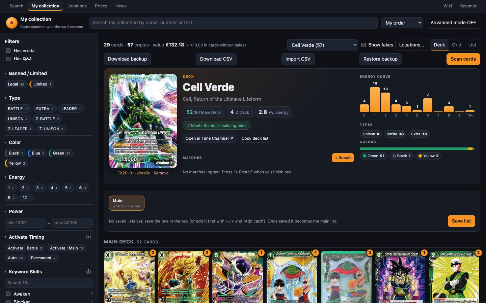

# Decks

A **deck** is a [location](ubicaciones.md) of type Deck. When you open it (`/collection/deck/<id>`, or by choosing it in My collection) you see it in the **Deck** view:
- the Leader;
- the Main Deck, the Z Deck and the Side Deck;
- the deck-building rules check;
- stats;
- the list **versions**;
- the **matches** played.



## Box, main list and versions

These three ideas are the key to understanding decks:

- **The box** is what's physically in that location: the copies the site has recorded in the deck.
- **The versions** (v1, v2, v3…) are saved lists. Each time you change the deck and save, a new version is created, so you keep a history of how it has evolved.
- **The main list** (★) is the version that is, or should be, in the box. Matches are logged against it.

When the box and the main list match, everything adds up. If you move copies from outside (from My collection or the scanner), the site warns you that **the box has changed**.

## The deck header

### The Leader

- **See the other side:** tap the Leader to switch between **Front** ⟲ **Awaken**. The Awaken side is shown by default.
- **“number · details”** opens its card page.
- **Remove** takes it out of the list. To put in another one, use **Add card**.

### Counters

- **“N/60 Main Deck”**: green when you're between 50 and 60.
- **“N Z Deck”**.
- **“X.X Av. Energy”**: the average cost of the Main Deck.
- **“N side”**: if there's a side deck.

### Deck-building rules

If everything is fine it reads **✓ Meets the deck-building rules**. If not, **⚠ N deck-building warnings**, which expands:

| Warning | Rule |
|---|---|
| The Leader card is missing | Every deck needs a Leader. |
| N cards short of 50 | 50 cards minimum in the Main Deck. |
| N cards too many (max 60) | 60 cards maximum in the Main Deck. |
| BT1-030 Name: N copies (max 4) | 4 copies max of the **same number**, adding up all its printings (normal + alt-art…) across the Main and Z Deck. |
| … is Banned | It can't be played. |
| … is Limited: 1 copy max | Only 1 copy. |
| Ultimate: 1 copy max | Cards with [Ultimate]. |
| Super Combo: 4 max in the deck | 4 [Super Combo] cards max. |
| Dragon Ball: 7 max in total | 7 [Dragon Ball] cards max. |
| There are N Leader cards in the deck | It's a warning, not an error. |

Each card with a problem carries a mark with the reason.

> [!NOTE]
> The rules are checked on the **Main Deck** (and the Z Deck for the 4 copies). The **side deck isn't checked**.

### Stats

- **Energy curve:** cost bars from 0 to 10+.
- **Types:** Battle, Extra, Unison.
- **Colors:** colour split.

**Tap any bar or colour to filter the list**: for example, to see only the cards that cost 2. Each section then says “X of Y cards”. **✕ Clear filters** shows everything again.

### Exporting the deck

Under the rules check there are two buttons. They take **the list you're looking at**: the main list (with any unsaved changes) or the saved version you picked.

- **Open in Time Chamber ↗** opens the deck in [Time Chamber](https://time-chamber.net/), the online Masters simulator and deck builder, in a new tab: Leader, Main Deck, Z Deck and Side Deck. You don't need an account to see it or play it there; you do to save it.
- **Copy deck list** copies the list as text, by sections, ready to paste in TCGArena, Discord or a message:

```
_____Leader_____
Cell // Cell, Return of the Ultimate Lifeform [EX20-01]

_____Main Deck_____
2 Android 20, Vile Creator [BT5-070]
4 Dormant Potential Unleashed [BT10-088]
…
```

Different printings of a card (alt arts, promos) share the card number, so they're added together: 1 + 3 copies of BT10-088 become **4 Dormant Potential Unleashed**. Only card numbers leave the app, and only when you press the button.

## The list sections

- **Main Deck**.
- **Z Deck**: cards whose type starts with “Z-” (Z-BATTLE, Z-EXTRA…).
- **Side deck**.

Fake copies in the box also count in the list, because they're physically in the deck.

## Preparing changes (the draft)

With the **Main** tab selected you can prepare a new list **without moving anything yet**:

- **− / +** on each card changes its copies (from 0 to 99).
- **→ Side** moves a copy to the side deck; **↩ Deck** brings it back.
- **+ Add card** (at the end of the Main Deck) opens a search over the whole catalogue. Type at least 2 letters of the name, number or text and tap a card to add a copy; you can tap it several times. **Done** closes the search.
- **Each change** shows on the card as **+N** or **−N**: “Unsaved change compared with what's in the box”.

The draft is saved in your browser: if you reload the page, it isn't lost. **Discard** throws it away.

> [!TIP]
> The draft doesn't touch your collection. It's for trying out ideas (“what if I take out 2 of this and put in 2 of that?”) and seeing straight away how the curve and the rule warnings look.

### Ordering the cards

With no pending changes and no filters, you can **drag the cards** within their section to order them however you like. On mobile, press and hold the card before dragging.

## Saving the list

**Save list** opens “Save list vN”, with two optional fields: **Name** (e.g. “More removal”) and **Notes**.

- **If the cards are already in the box:** “✓ These cards are already in the deck box: the list will become the main one.”
- **If not:** it shows you which copies would need to move and lets you choose between two buttons:
  - **Just save**: saves the version without touching the box;
  - **Save and make main (N copies)**: saves and also moves the copies.

A version that matches the box exactly (side included) becomes the main one automatically.

## Making a version main (moving copies)

When you choose a version in the lists bar, its details and buttons appear:
- **“vN · saved …”**, with the **★ main** and **automatic** tags;
- **Changes since vN**: what changed compared with the previous one;
- **Make main**, or **Rearrange the box** if it's already the main one but the box has changed;
- **Rename** and **Delete**. You can only delete a version with no matches, and deleting it doesn't move any cards.

**Make main** **really** moves copies in your collection so the box ends up the same as that version. Before doing it, it shows you the plan:

- **Leaving the box N copies**:
  - they go to **Move them to**, which is Unsorted by default;
  - you can choose another destination for each card;
  - fakes leave first.
- **Entering the box N copies**:
  - for each card you see where it's taken from (for example “From: Unsorted 2 + Box 3 1”). It goes to Unsorted first, then binders and boxes, and as a last resort other decks;
  - you can force the source for each card.
- **Possible warnings:**
  - **“⚠ Copies will be taken from other decks”**;
  - **“⚠ N copies missing”**, if you don't have enough. The box will be incomplete until you get them;
  - **“⚠ What's in the box right now isn't saved as a list”**. Save it first if you want to be able to go back to it.

Press **Move N copies and make main**. When it's done, it sums up how many left and how many came in.

> [!IMPORTANT]
> The site moves the copies **in your collection**. Make the same move with the real cards so everything keeps adding up.

## Matches

The **Matches** panel keeps your results with the deck.

- **+ Result** opens the **Log result** form:

  | Field | Detail |
  |---|---|
  | **Opponent Leader** | Find the opponent's Leader by name or number. It offers the last 6 you've logged. If it isn't in the catalogue, **Use “text” without a card**. |
  | **Result** | **Win**, **Loss** or **Draw**. |
  | **Date** | Today by default. Future dates aren't allowed. |
  | **Opponent** | The opponent's name, with autocomplete. |
  | **Who went first?** | **Me**, **Opponent** or “—”. |
  | **Score** | For example “2-1”. |
  | **Event** | Tournament, store, casual…, with autocomplete. |
  | **Notes** | What worked and what was missing. |

  The match is logged with the **main list**. If the box has changed since the last version, a new automatic version is saved first; that way each match knows which list it was played with.

- **The summary** shows:
  - the **win %** and the total number of matches;
  - **W / L / D**;
  - an **Against** table with the latest opposing Leaders and your record against each one.
- **See all matches (N) →** opens the full list, with ✎ to edit and 🗑 to delete each match.
- **Matches by version:** when you select a version, the panel becomes “Matches with vN” and only shows those played with that list. That way you can compare which version works best.

## The archive

When you stop playing a deck, instead of deleting it, **move it to the archive** from [Locations](ubicaciones.md#move-to-archive-decks-only):
- its list stays saved;
- the cards go back to Unsorted;
- its matches are kept.

To play it again, **Use again** brings its Leader into the box and, with **Make main** on its latest version, you get the rest of the cards back.
