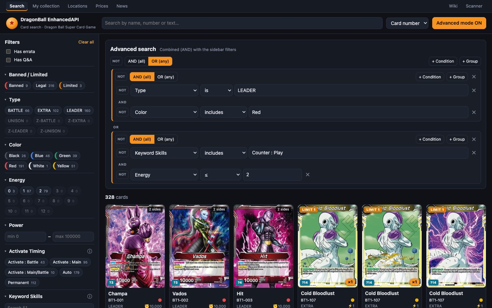

# Advanced mode

The filters panel covers almost everything, but it has two limits: **different fields always combine with AND**, and you can't **negate** anything. **Advanced mode** removes those limits. With it you build the search as a tree of conditions joined by **AND**, **OR** and **NOT**, nested as deep as you need.



## Turning it on

Press **Advanced mode OFF** in the header to switch it to **ON**. The **Advanced search** panel appears above the results, with the reminder “Combined (AND) with the sidebar filters”.

- **When you turn it off** (OFF), the tree **is kept** but no longer applied. When you switch back to ON it's still there.
- **It combines with everything else**: the results match the free text, the sidebar and the advanced tree all at once.

## Groups and conditions

The tree starts with a **root group**. While it's empty it says “Add conditions to refine the search. You can nest AND / OR groups.”

**Buttons on each group:**

| Button | What it does |
|---|---|
| **NOT** | Negates the whole group: you get the cards that *don't* match it. |
| **AND (all)** / **OR (any)** | Whether all of the group's conditions must match or just one is enough. |
| **+ Condition** | Adds a condition to the group. |
| **+ Group** | Adds a subgroup inside it. It starts with the opposite operator to its parent group, which is usually what you want. |
| **✕** | Removes the group (the root can't be removed). |

Between a group's children you see the **AND** or **OR** connector, so you can read the search at a glance.

**Parts of each condition**, from left to right:
- **NOT** to negate it;
- the **field**;
- the **operator**;
- the **value**;
- **✕** to remove it.

A new condition starts as “Keyword (Exact Value)” “includes”.

> [!NOTE]
> Half-finished conditions (with no value) and empty groups **are ignored**: they don't filter anything. That way you can build up the tree without the results dropping to zero at every step.

## The fields

In the selector, the fields are grouped:

| Group | Fields |
|---|---|
| **Text** | **Card Name**: searches the name of both sides · **Card Text**: text of both sides, ignoring brackets and case · **Card Number** |
| **Set** | **Series** · **Set Code** · **Card Set** (the expansion's full name) · **Regulation** |
| **Tournament** | **Banned / Limited** · **Has Errata** · **Has Q&A** |
| **Attributes** | **Type** · **Color** · **Rarity** · **Energy** · **Color Cost** · **Combo Energy** · **Combo Power** · **Power** · **Power (Back Side)** · **Z-Energy Cost** · **Character** · **Special Trait** · **Era** · **Double-Sided** |
| **Skills** | **Activate Timing** · **Keyword Skills** · **Keywords** · **Keyword (Exact Value)** · **Mentioned Keyword** · **Keyword Family** |

Some fields **only exist here**, not in the panel:
- **Card Set** and **Regulation**;
- **Double-Sided**;
- **Keyword (Exact Value)**: the skill exactly as it appears on the card, with its number. For example `Over Realm 4`.
- **Mentioned Keyword**: words in brackets that the card **mentions** but doesn't have. For example, a card that says “…it gains [Barrier]” *mentions* Barrier.
- **Keyword Family**: the skill without its number (`Limit 1` → `Limit`; `Counter : Play` → `Counter`).
- **Card Name**, **Card Text** and **Card Number** separately. The search box searches all three at once.

## The operators

Each type of field has its own operators:

| Field type | Operators |
|---|---|
| **Text** (Card Name, Card Text, Card Number) | **contains** · **is** (equal, not case-sensitive) · **starts with** |
| **Number** (Energy, Power…) | **is** · **≠** · **<** · **≤** · **>** · **≥** · **between** (min and max) · **has no value** |
| **One of several** (Type, Rarity, Series…) | **is** · **is one of** |
| **List** (Color, Special Trait, Keyword Skills…) | **includes** · **includes any of** · **includes all** · **is empty** |
| **Yes / No** (Has Errata, Double-Sided…) | **is** |

> [!WARNING]
> - **≠ on numbers** also leaves out cards *without* that value. “Power ≠ 10000” doesn't return EXTRAs, which have no Power. If you want them, use **has no value** in another condition with OR.
> - **“is” on “one of several” fields** is case-sensitive: `LEADER`, not `leader`. Pick the value from the suggestions to avoid mistakes.

## Typing the values

- **Suggestions**: as you type, the existing values appear, with “N cards” next to them.
- **Several values** (is one of / includes any of / includes all): each value is a tag.
  - <kbd>Enter</kbd> adds what you've typed.
  - Picking a suggestion adds it directly.
  - <kbd>⌫</kbd> with the box empty deletes the last tag.
- **between**: two boxes, **min** and **max**.
- **has no value**, **is empty** and Yes/No fields: a **Yes** / **No** selector.

## Examples

**Red Leaders, or cards with [Counter : Play] costing 2 or less** (the screenshot above):

```
OR (any)
├── AND (all)
│   ├── Type is LEADER
│   └── Color includes Red
└── AND (all)
    ├── Keyword Skills includes Counter : Play
    └── Energy ≤ 2
```

**Blue Saiyans that are NOT Ultimate:**

```
AND (all)
├── Special Trait includes Saiyan
├── Color includes Blue
└── NOT  Keyword Skills includes Ultimate
```

**Cards that give Barrier to others but don't have it themselves:**

```
AND (all)
├── Mentioned Keyword includes Barrier
└── NOT  Keyword Skills includes Barrier
```

**Cheap Extras from any Zenkai set (BT14 onwards):**

```
AND (all)
├── Type is EXTRA
├── Energy ≤ 1
└── Set Code is one of BT14, BT15, BT16, …
```

## Limits

- **Nesting:** 6 levels max.
- **Conditions:** 60 in total.
- **Values:** 100 per condition.

If you go over, an error appears in red next to the results counter.

## Saving and sharing

The tree is stored in the address (`?advanced=…`), so **an advanced search can be bookmarked or shared** like any other. If the tree exists but the mode is OFF, the address also includes `advanced_on=0`. More in [Links, addresses and shortcuts](enlaces-y-navegacion.md).
