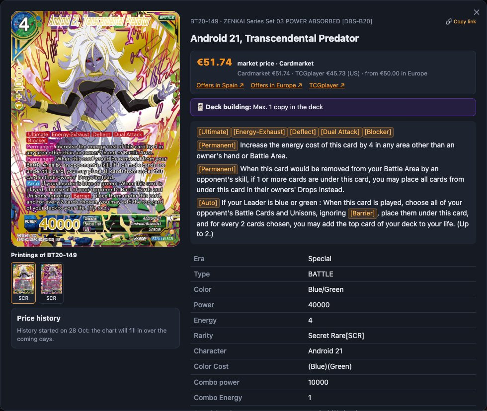

# Where each price comes from

Every card in the catalogue has, whenever possible, a **price in euros**. It comes from cross-checking **Cardmarket** (the European market) with **TCGplayer** (the US one), plus any prices you set by hand. This article walks through the rules, step by step, so you know when to trust a price and when not to.

## The sources

### Cardmarket

Every day Cardmarket publishes a public **catalogue** and **price guide** for all its Dragon Ball Super products. For each product it gives:
- the **trend**;
- the **average sale prices** over 1, 7 and 30 days;
- the **cheapest listing** (low).

This data covers **all of Europe** and mixes languages.

### TCGplayer

TCGplayer is the United States market. Its data comes through **tcgcsv.com**, which publishes a daily dump. Its **market price**, based on real sales, is used, converted from dollars to euros with the **official ECB exchange rate** for each day.

### By hand

In the admin's [price review](revisar-precios.md) you can set a card's price by hand. **A price set by hand always wins.**

## Cardmarket's reference price

Cardmarket's data sometimes has odd spikes (a trend inflated by a one-off sale, an average gone wild…). To avoid relying on a single figure, **the lowest** of these three is taken:

1. the **trend**;
2. the **median** of the 1-, 7- and 30-day averages;
3. **3 times the cheapest listing**.

**If there are no sales** (a set that just came out, an extremely rare card), only the cheapest listing is left. It's used, but flagged as **“no sales”**: it's what a seller *asks*, not what people pay.

## How they're combined

| Situation | Price used | Counts in the value? |
|---|---|---|
| There's a price **set by hand** | That one | Yes |
| Cardmarket **with sales** | Cardmarket… | Yes |
| …but TCGplayer is **less than half** | TCGplayer (corrects prices inflated in Europe) | Yes |
| Cardmarket **without sales** and there's TCGplayer | The **lower** of the two (if the listing isn't suspicious) | Yes |
| **Only** a listing on Cardmarket | That listing, as “from €X” | **No** |
| Nothing | No price | — |

In the card details, the sources line (“Cardmarket €X · TCGplayer €Y (US) · from €Z in Europe”) lets you see whether they agree.

## Cards “without sales”

A card that only has a listing on Cardmarket and nothing else is shown as **“from €X”**, with the text “only a seller's asking price: no sales (not counted in the value)”. Its amount **isn't added** to your collection's value. It's shown separately, as “(+ €Y in cards without sales)”, so you can keep it in mind without inflating the total.

## Suspicious prices

A listing without sales can be absurd: someone asking €9,999 for a €2 card. A listing is considered **suspicious** when:
- it's the only data point (no sales in any source);
- and it's **above the 99th percentile** of the cards of the same rarity that do have sales. There must be at least 20 cards of that rarity to compare against.

Suspicious prices **don't count for anything**, not even in the “separately” amount, until someone reviews them. In the card details they show as “doubtful price: a single listing, no sales”.

## Matching each card with its product

The tricky part is knowing **which Cardmarket product each card is**, because Cardmarket doesn't give the card number or its rarity: only the expansion and the name. Automatic matching:

- **Expansions:** matches each set with its Cardmarket expansion and leaves Fusion World out.
- **Names:** compares names, using the hints Cardmarket puts in them (number, set, color) and the “front // back” form of Leaders.
- **Several printings with the same name in a set** (regular and alt-art): sorts them by rarity and price.
- **Reprints** (the same card in a Starter Deck or another set): copy the price of the **original** printing, never the other way round, and only if they aren't promos.
- **Promos:** don't copy the price of the regular version, because a tournament promo can be worth ten times more. Each promo looks for its own product; if in doubt, it's left **unmatched** for you to review.
- **Printings created by hand from TCGplayer:** point straight at their exact product.

Anything that can't be decided safely goes to the [price review](revisar-precios.md). **Your choices are remembered** and take priority in every later update.

## Fake copies

Copies marked as [fake](mi-coleccion.md#fake-copies) **never count** towards any value.

## When it's updated

Everything is recalculated **every day at 05:15** (Madrid time). Cardmarket publishes its guide around 03:00. On each update:
1. Cardmarket's catalogue and guide are downloaded;
2. the matches are redone, respecting yours;
3. the dollar exchange rate is downloaded;
4. TCGplayer is downloaded (only if tcgcsv has new data);
5. each card's price is recalculated and recorded in the history;
6. the **dump** `data/precios_dbs.json` is rebuilt.

## The price dump

So that a **new installation** starts with prices already in place, the repository ships a dump of everything on this page in `data/seed/precios_dbs.json.gz` (~1 MB), and the server rebuilds another one every day in `data/precios_dbs.json`. They include:
- the Cardmarket and TCGplayer products and matches;
- **your choices and hand-set prices** from the review;
- the dollar exchange rate;
- each card's price and its history.

When starting with a database that has no prices, the most recent one is imported automatically. See [Step-by-step installation](instalacion.md#the-data-included-in-the-repository).

| Command | What it does |
|---|---|
| `make export-prices` | Rebuilds the dump now |
| `make import-prices` | Loads the dump, **replacing** the current prices |
| `make seed` | Updates the repository's dumps (`data/seed/`) |

If there's no dump, the worker downloads the prices as soon as there's a catalogue.

## The history

- **What's stored:** only prices that **count in the value**, and only on the days they change.
- **Since when:** it started on **28 October 2026**. There's no earlier data: tcgcsv's public history archive is no longer available.
- **What it's used for:**
  - the chart in the card details;
  - the 7- and 30-day change;
  - the [Prices](pagina-precios.md) page.
