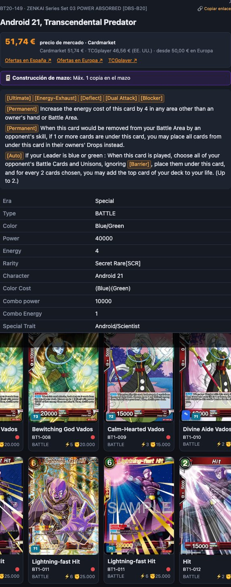

# Enlaces, direcciones y atajos

Casi todo lo que ves en la web tiene **su propia dirección**: una búsqueda, una carta, una ubicación o un mazo. Copia la dirección del navegador y, al abrirla en otro sitio, verás lo mismo. Sirve para guardar búsquedas en favoritos, mandarte una carta al móvil o enlazar un mazo.

## Las páginas

| Dirección | Página |
|---|---|
| `/` | [Buscador](buscar-cartas.md) |
| `/collection` | [Mi colección](mi-coleccion.md) |
| `/collection/location/<id>` | Mi colección dentro de una ubicación (caja, archivador…) |
| `/collection/deck/<id>` | Un [mazo](mazos.md) |
| `/locations` | [Ubicaciones](ubicaciones.md) |
| `/prices` | [Precios](pagina-precios.md) |
| `/news` | [Novedades](novedades.md) |
| `/scan` | [Escáner](escaner.md) |
| `/wiki` | Esta wiki |
| `/admin/` | [Admin de Django](admin.md) |

Una dirección que no existe muestra la página **«ERROR 404 · Página no encontrada»**, con botones para ir al Buscador o a Mi colección.

El `<id>` de una ubicación es un código fijo: aunque cambies el nombre de la caja o del mazo, el enlace sigue valiendo.

## Enlace a una carta



Cualquier página que abre fichas acepta `?card=` con el **número de la carta**:

- `?card=BT20-149` abre la **primera** impresión de BT20-149.
- `?card=BT20-149-2` abre la segunda, `-3` la tercera, y así. Van en el orden en que se dieron de alta. Las impresiones nuevas siempre van al final, así que los enlaces que ya compartiste no cambian.
- Los enlaces antiguos con el número interno de Bandai (`?card=54229`) siguen funcionando.
- El número no distingue mayúsculas: `?card=bt20-149` también vale.

Ejemplos:
- `http://192.168.1.50:5173/?card=BT20-149`: la carta en el Buscador.
- `http://192.168.1.50:5173/prices?card=P-428`: la carta, abierta encima de la página de Precios.

Para no tener que escribirlo, usa **🔗 Copiar enlace** en la ficha. Al abrir una ficha la dirección cambia sola a `?card=…`, y al cerrarla vuelve a quitarse. Si el número no existe, se quita de la dirección sin dar error.

## La búsqueda en la dirección

El Buscador y Mi colección escriben su estado en la dirección, pero solo lo que no tiene el valor por defecto:

| Parámetro | Qué guarda | Ejemplo |
|---|---|---|
| `q` | Texto buscado | `?q=goku barrier` |
| `sort` | Orden: `number`, `newest`, `-newest`, `name`, `energy`, `-energy`, `power`, `-power` (y en la colección `quantity`, `position`) | `?sort=-power` |
| `page` | Página, a partir de la 2 | `?page=3` |
| `filters` | Filtros del panel, en JSON | `?filters={"color":{"values":["Red"],"match":"any"}}` |
| `advanced` | Árbol del [Modo avanzado](modo-avanzado.md), en JSON | |
| `advanced_on=0` | El árbol está guardado pero el modo está en OFF | |
| `view` | Mi colección: `grid`, `list` o `deck` | `?view=list` |
| `fakes=1` | Mi colección: mostrar también las falsas | |
| `card` | La carta abierta | `?card=BT20-149` |

Un ejemplo completo: las cartas rojas de Power 20000 o más, ordenadas de mayor a menor:

```
/?sort=-power&filters={"color":{"values":["Red"],"match":"any"},"power":{"values":[],"min":20000,"max":""}}
```

> [!TIP]
> Las búsquedas que repites a menudo (tus Leaders, las Banned, las cartas de un set) guárdalas en **favoritos del navegador**. Es la forma más rápida de volver a ellas.

### Enlaces antiguos

La web pasó de direcciones en español a direcciones en inglés. Los enlaces viejos se convierten solos al abrirlos:
- `/coleccion` → `/collection`
- `/coleccion/mazo/…` → `/collection/deck/…`
- `/ubicaciones` → `/locations`
- `/escaner` → `/scan`
- `orden`, `pagina`, `vista`, `falsas`, `filtros`, `avanzado` → sus equivalentes en inglés

## Atajos de teclado

| Tecla | Dónde | Qué hace |
|---|---|---|
| <kbd>Esc</kbd> | Ficha de carta | La cierra |
| <kbd>Esc</kbd> | Panel de filtros en el móvil | Lo cierra |
| <kbd>Esc</kbd> | Imagen ampliada de la wiki | La cierra |
| <kbd>Enter</kbd> | Valores del Modo avanzado | Añade el valor escrito |
| <kbd>⌫</kbd> | Valores del Modo avanzado, con la caja vacía | Borra el último valor |

## El menú y los avisos

- **El menú de arriba** es el mismo en todas las páginas: Buscador, Mi colección, Ubicaciones, Precios, Novedades, Wiki y Escáner.
- **Aviso rojo bajo el menú:** algo importante está caído. Hay cinco casos:
  - la base de datos no responde;
  - Redis no responde;
  - el escáner no está disponible;
  - las tareas en segundo plano están paradas;
  - el servidor no responde.

  Se comprueba al cargar, cada minuto y al volver a la pestaña. Con **×** lo ocultas en esa pestaña, pero vuelve a salir si cambia lo que falla. Ver [Tareas programadas y avisos](tareas-programadas.md#salud).
