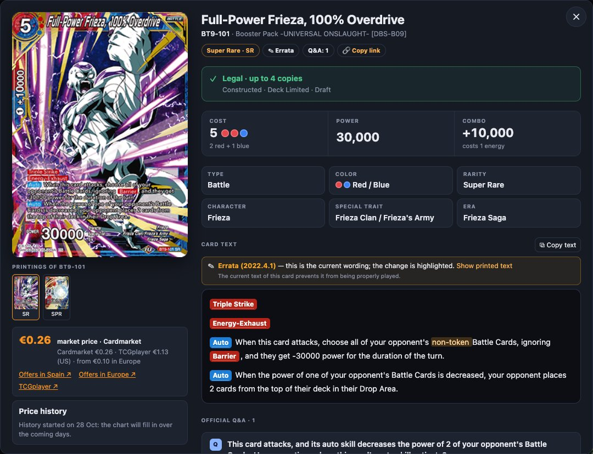
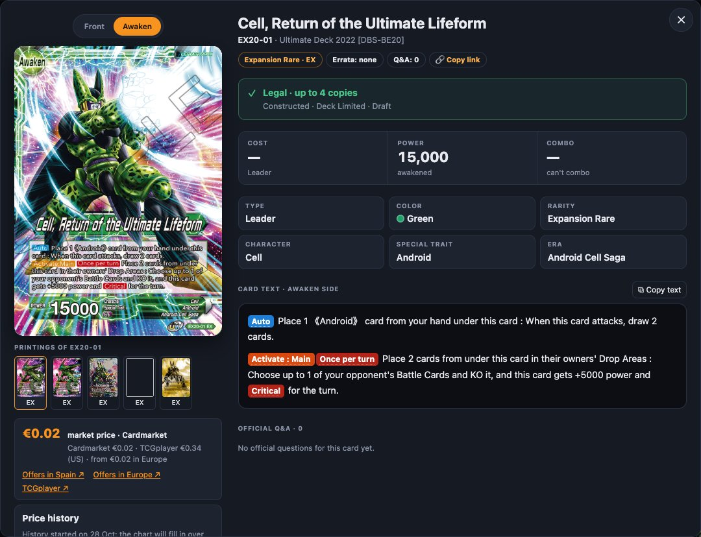
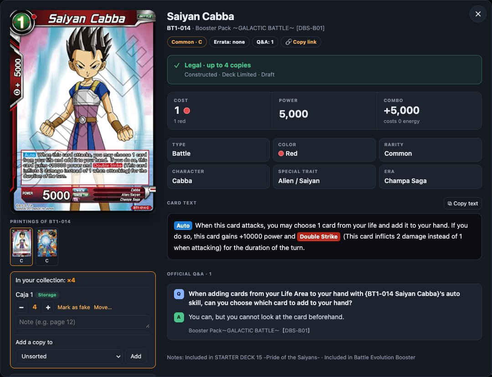

# La ficha de una carta

Al hacer clic en una carta (en «Search», «My collection», «News» o «Prices») se abre su **ficha**. Está ordenada como la lee un jugador: **a la izquierda, la carta física** (imagen, impresiones, tus copias y su precio) y **a la derecha, todo lo que necesitas para jugarla**, por orden de importancia.

**Para cerrarla:** pulsa **✕**, haz clic fuera de la ficha o pulsa <kbd>Esc</kbd>.

**Para pasar a la carta anterior o siguiente** de tus resultados sin cerrarla: las flechas **‹ ›** de los lados o las teclas <kbd>←</kbd> <kbd>→</kbd> (no se activan mientras escribes una nota).

En el móvil la ficha ocupa toda la pantalla, con una barra arriba con el nombre de la carta, **‹ ›** y **✕**; la imagen es más pequeña, con sus impresiones al lado, y tus copias y el precio van después de las Q&A.

## Columna izquierda: la carta física

### La imagen y sus caras

Las cartas de **dos caras** tienen dos botones encima de la imagen: **«Front»** (frente) y **«Awaken»** (despertada) en los Leaders (**«Back»** en otras cartas de dos caras). Cambiar de cara cambia la imagen, el nombre, el poder y el texto.

### Impresiones del mismo número

Si un número tiene varias impresiones (normal, alt art, SPR, promos de torneo…), debajo de la imagen sale **«Printings of BT20-149»** (impresiones de BT20-149), con una miniatura de cada una y su rareza. La que estás viendo va marcada; pulsa otra para abrirla. Al pasar el ratón se ve su enlace, rareza y colección.

### Tus copias

Debajo de la imagen está el panel de **tus copias** de esa carta. Dice «Not in your collection» o «In your collection: ×3», más «1 fake» si tienes alguna falsa.

**Una fila por ubicación**: las copias que están en un mazo llevan la etiqueta **«In deck»** (en un mazo); las demás, su tipo («Binder», «Storage»). Las copias falsas van en su propia fila, marcada **«Fake»**. En cada fila:
- **− / +**: quita o añade una copia en esa ubicación. Las filas de falsas no tienen **+**.
- **«Mark as fake»** / **«It's genuine»**: cambia **una** copia de auténtica a falsa o al revés. Si en esa fila hay varias copias y la nota tiene posiciones (por ejemplo, del archivador), pregunta **«Which one is the fake?»** y ofrece cada posición.
- **«Move…»**: mueve copias a otra ubicación: «Move [n] to [ubicación] → Move».
- **«Note»**: texto libre de hasta 500 caracteres. Se guarda al salir del campo. Ejemplos: «página 12» o, para una falsa, «AliExpress, junio».

**«Add to My collection in» [ubicación] → «Add»** suma una copia auténtica en una ubicación donde todavía no tienes esa carta. Te propone la última ubicación que usaste en este navegador, o «Unsorted» (sin ubicar).

> [!NOTE]
> Este panel solo aparece cuando la carta está en la página de resultados que tienes abierta. Si la abres desde un enlace o desde la fila de impresiones y no está en esa página, no sale. Búscala y ábrela desde los resultados.

Todo sobre copias, ubicaciones y falsas está en [Mi colección](mi-coleccion.md).

### El precio

**La cifra grande:**
- **«€51.74»**: precio de mercado.
- **«from €11.60»** (desde): solo hay el anuncio de un vendedor, sin ventas reales.

**Debajo, de dónde sale:**
- **«market price · Cardmarket»** o **«· TCGplayer»**: sale de ventas reales.
- **«price set by hand»**: lo pusiste tú en la [revisión de precios](revisar-precios.md).
- **«only a seller's asking price: no sales (not counted in the value)»**: solo el precio que pide un vendedor, sin ventas; no cuenta en el valor.
- **«doubtful price: a single listing, no sales (not counted in the value)»**: un anuncio desproporcionado para su rareza, pendiente de revisar.

**Línea de fuentes:** «Cardmarket €51.74 · TCGplayer €46.56 (US) · from €50.00 in Europe». Así ves de un vistazo si las fuentes coinciden. **Variación:** «7 days: ▲ 3%», «30 days: ▼ 8%».

**Enlaces:** **«Offers in Spain ↗»** (Cardmarket, vendedores de España, cartas en inglés), **«Offers in Europe ↗»** (toda Europa) y **«TCGplayer ↗»** (si la carta está emparejada). Si la carta no tiene producto en Cardmarket, los enlaces llevan a una búsqueda por su nombre.

**Historial de precio:** si el precio cuenta en el valor, el gráfico va debajo, con **«30 days»**, **«90 days»** (por defecto) y **«All»**, cuánto ha cambiado en ese periodo y el precio de cada día al pasar el ratón. El historial empezó el **28 de octubre de 2026**; hasta que haya un segundo dato dice «History started on 28 Oct: the chart will fill in over the coming days».

Cómo se elige cada precio, con todas sus reglas, está en [De dónde sale cada precio](precios.md).

## Columna derecha: jugar la carta

### Nombre, número y enlace

Arriba: el **nombre**, **número · nombre de la colección** y unas etiquetas: la **rareza**, **«✎ Errata»** (o «Errata: none»), **«Q&A: N»** y **«🔗 Copy link»** (copiar enlace). El botón copia la dirección de esta carta; al pegarla en otro sitio se abre directamente esta ficha. Al copiarla dice **«Link copied ✓»**. Si el navegador no deja copiar, sale el enlace seleccionado para que lo copies tú. Ver [Enlaces, direcciones y atajos](enlaces-y-navegacion.md#enlace-a-una-carta).

### ¿La puedo jugar?

Justo debajo del nombre, una franja con icono dice si la carta puede ir en un mazo:
- **«✓ Legal · up to 4 copies»** (verde: legal, hasta 4 copias), con los formatos en los que es legal (Constructed · Deck Limited · Draft).
- **⚠** (ámbar) para un límite: **«Limited · 1 copy max (deck + side deck)»** (como mucho 1 copia entre el mazo y el side deck), o una regla de construcción de sus habilidades, por ejemplo **«Max. 1 copy in the deck»** para [Ultimate], [Super Combo] (4 como mucho en el mazo) o [Dragon Ball] (7 en total).
- **«⛔ Banned in official tournaments»** (rojo: prohibida en torneos oficiales): no puede ir ni en el mazo ni en el side deck.

Banned y Limited enseñan la fecha desde la que se aplican.

### Cost, Power y Combo

Los números con los que construyes, en grande y uno al lado de otro:
- **«Cost»**: el coste de energía con los **puntos del coste de color** y, debajo, «2 red + 1 blue» (2 rojos + 1 azul). Las cartas Z enseñan su coste **«Z-Energy»**.
- **«Power»**: en los Leaders cambia con la cara («front side» / «awakened»).
- **«Combo»**: el poder que suma («+10,000») y lo que cuesta («costs 1 energy»), o «can't combo» (no puede hacer combo).

### Datos

Seis baldosas: **«Type»**, **«Color»**, **«Rarity»**, **«Character»**, **«Special trait»** y **«Era»**. **«Type», «Character», «Special trait» y «Era» son botones**: al pulsar uno, «Search» filtra por él.

### Texto de la carta

El texto vigente de la carta, en grande y con cada habilidad en su color, como en la carta impresa: **Auto** en azul, **Activate** en naranja, **Permanent** en rosa y las keyword skills ([Barrier], [Blocker]…) en rojo. Los costes de color dentro del texto salen como puntos de color.

- **Pulsa una habilidad** para ver su explicación oficial en un recuadro; desde ahí, **«Filter cards with [Barrier] →»** busca las cartas con esa habilidad. <kbd>Esc</kbd> o pulsar fuera lo cierra.
- **«⧉ Copy text»** copia el texto (con la errata aplicada).

**Errata:** si Bandai ha publicado una, el texto que ves ya es **el vigente**, con lo que cambió **resaltado**, y encima una nota con su fecha y la explicación de Bandai. **«Show printed text»** cambia al texto tal como se imprimió, con lo que se quitó tachado.

### Q&A oficiales

Las preguntas oficiales sobre la carta, como **Q** (pregunta) y **A** (respuesta), con la colección de la que salen. Las dos primeras salen abiertas; pulsa una pregunta para abrirla o cerrarla. Las que Bandai marca como recientes llevan la etiqueta **«new»**. Si no hay: «No official questions for this card yet».

### Notas

Al final, las notas de Bandai sobre la carta, si las tiene (por ejemplo, en qué productos viene).
