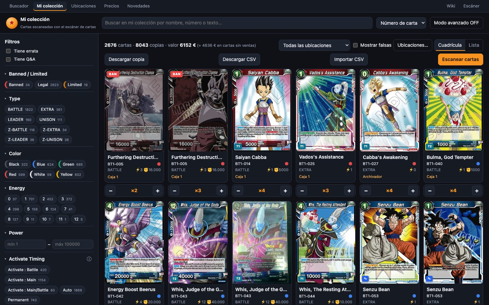
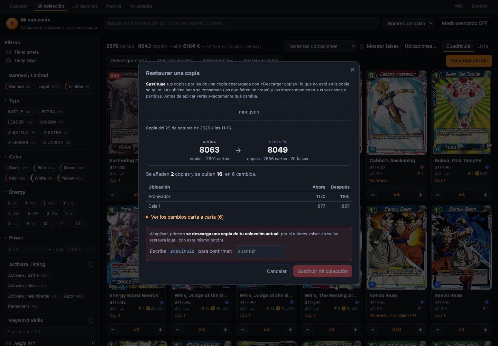

# Importar, exportar y copia de la colección

En la barra de [Mi colección](mi-coleccion.md) hay cuatro botones para sacar y meter datos:

| Botón | Qué hace |
|---|---|
| **«Download CSV»** | Descarga tu colección en una hoja de cálculo. |
| **«Import CSV»** | Suma a tu colección las copias de un CSV. |
| **«Download backup»** | Descarga una copia completa en JSON: ubicaciones, cartas, copias, falsas y notas. |
| **«Restore backup»** | Vuelve tu colección al estado de esa copia (**sustituye**), con vista previa y confirmación. |

## Descargar CSV

Descarga `my-collection-AAAA-MM-DD.csv`, pensado para abrirlo directamente en **Excel en español** (separador `;`, codificación UTF-8 con BOM). Tiene una fila por cada carta + ubicación + auténtica/falsa:

| Columna | Contenido |
|---|---|
| `id` | Número interno de la carta en Bandai: identifica la impresión exacta. |
| `number` | BT20-149 |
| `name` | Nombre de la carta |
| `set` | Set (expansión) |
| `location` | Nombre de la ubicación |
| `quantity` | Copias |
| `fake` | `yes` / `no` |
| `notes` | La nota de esa fila |

## Importar CSV

**Suma** las copias del fichero a tu colección: **no borra ni cambia nada** de lo que ya tienes.

1. Pulsa **«Import CSV»** y luego **«Choose file…»**.
2. Se analiza el fichero y aparece una vista previa: «**X** copies in **Y** rows (Z of them fake). N rows will be skipped.», con el motivo de cada fila saltada («Row 12: Card not found…»).
3. Si alguna ubicación del fichero no existe, se avisa: esas cartas irán a «Unsorted» (sin ubicar).
4. Pulsa **«Add X copies»**. Se aplica todo de golpe (o todo o nada) y se confirma con «✔ Added **N** copies to your collection.»

### Formato que acepta

- **Separador:** `;`, `,` o tabulador. Se detecta solo.
- **Cabeceras:** dan igual las mayúsculas y las tildes, y valen en inglés:

| Dato | Cabeceras válidas | ¿Obligatorio? |
|---|---|---|
| Carta | `id` / `bandai_id`, **o** `número` / `number` / `card_number` | Sí, una de las dos |
| Cantidad | `cantidad` / `qty` / `quantity` / `copias` | Sí |
| Edición | `edición` / `set` / `card_set` | Si el número tiene varias impresiones |
| Ubicación | `ubicación` / `location` | No (vacía → «Unsorted») |
| Falsa | `falsa` / `fake` (vale `sí`, `s`, `yes`, `y`, `true`, `1`, `x`) | No |
| Notas | `notas` / `notes` | No |
| Nombre | `nombre` / `name` | No (solo informativo) |

- **Cómo se busca la carta:** primero por `id`. Si no hay id, por número, y si hay varias impresiones de ese número, por la edición. Si aun así es ambigua, esa fila se salta con el aviso «is ambiguous: add the id or set column».
- **Ubicaciones:** se buscan por nombre, sin tildes ni mayúsculas.
- **Notas:** se añaden como línea nueva si esa línea no estaba ya.
- **Límites:** 2 MB y 20.000 filas.

> [!TIP]
> El CSV de «Download CSV» se puede volver a importar tal cual. Para mover tu colección a otra instalación: descárgalo en una e impórtalo en la otra.

## Descargar copia (JSON)

Descarga `my-collection-AAAA-MM-DD.json` con:
- **todas tus ubicaciones**, también las vacías, con su tipo, copias, falsas y notas (y, en los archivadores, sus bolsillos por página);
- **cada carta en cada ubicación**: id, número, nombre, cantidad, falsa y notas;
- los totales: cartas, copias y falsas.

Está escrito con una línea por ubicación y otra por carta, así que también se lee bien con un editor de texto.

> [!TIP]
> Descarga una copia **antes de cambios grandes**: reorganizar ubicaciones, importar un CSV grande o desmontar varios mazos. Si algo sale mal, la restauras.

## Restaurar copia

**«Restore backup»** vuelve tu colección **exactamente** al estado de una copia JSON. A diferencia de «Import CSV», que solo suma, aquí **se sustituye**: lo que no esté en la copia se quita.

1. Pulsa **«Restore backup»** y, con **«Choose backup (.json)…»**, elige el fichero `.json` que descargaste con «Download backup».
2. **Vista previa.** Antes de cambiar nada, ves:
   - la **fecha** de la copia («Backup from …»);
   - **«Now» → «After»**: copias y cartas, también las falsas;
   - cuántas copias **se añaden** y cuántas **se quitan**;
   - las **ubicaciones que se crean**, porque están en la copia pero ya no existen;
   - las **ubicaciones que se quedan vacías**, que no se borran;
   - una tabla con cada ubicación que cambia (**«Now»** y **«After»**);
   - **«See the changes card by card»**, con el +/− de cada carta en cada ubicación;
   - las filas de la copia que **se saltan**, por ejemplo cartas que ya no están en el catálogo.

   Si la copia es igual que tu colección, lo dice y no hay nada que aplicar.
3. Para confirmar, **escribe `replace`** en la casilla roja («Type replace to confirm»). Hasta entonces el botón está desactivado.
4. Pulsa **«Replace my collection»**. Pasan dos cosas:
   - **primero se descarga una copia de tu colección actual**, para poder deshacerlo restaurando esa copia igual;
   - después se aplica todo de una vez: si algo fallara, no cambia nada.

**Qué se conserva:**
- **Las ubicaciones:** se emparejan por nombre (sin importar tildes ni mayúsculas) y no se borra ninguna. Las que falten se crean con su tipo y sus notas.
- **Los mazos:** mantienen sus **versiones y partidas**, que no van en la copia. El side deck se ajusta para que no tenga más copias de las que hay en la caja.
- **«My order»:** las cartas que siguen en la misma ubicación conservan su sitio; las nuevas van al final.
- **Las notas** de cada copia, como vienen en la copia.

> [!NOTE]
> Esta copia es solo de **tu colección**. La copia de seguridad de toda la base de datos (precios, partidas, escaneos…) se hace sola cada noche en el servidor: ver [Copias de seguridad](copias-de-seguridad.md).
