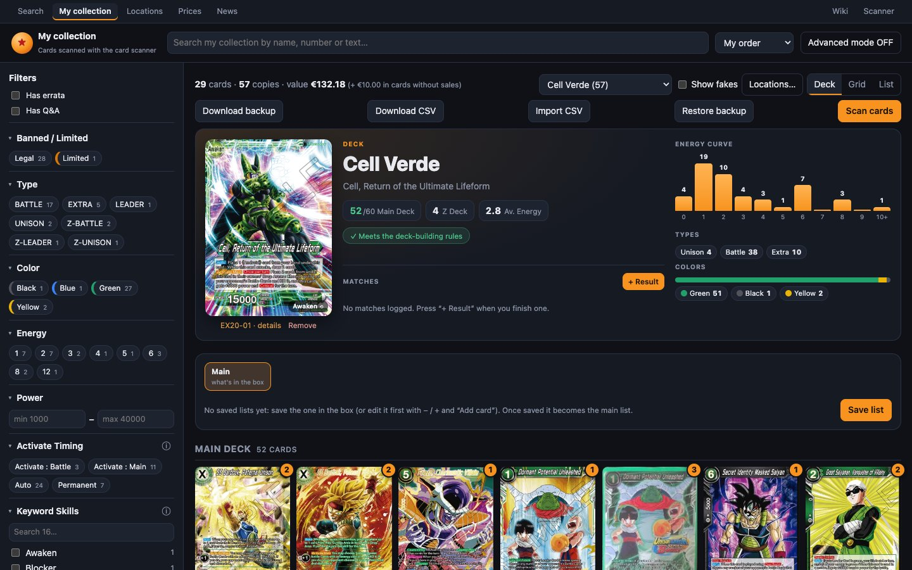

# Mazos

Un **mazo** es una [ubicación](ubicaciones.md) de tipo «Deck». Al abrirlo (`/collection/deck/<id>`, o eligiéndolo en «My collection») se ve en la vista **«Deck»**:
- el Leader;
- el Main Deck, el Z Deck y el Side Deck;
- la comprobación de las reglas de construcción;
- estadísticas;
- las **versiones** de la lista;
- las **partidas** jugadas.



## Importar un mazo de otra web

En **«Locations» → «Decks»**, **«⇩ Import deck»** (importar mazo) crea un mazo a partir de una lista que hayas visto en otra web, con las cartas que ya tienes:

1. Pega el **enlace del mazo** o la **lista**:
   - enlaces de **DeckPlanet** (`dbs-deckplanet.com/…/deck/…`), **Top Deck Diffusion** (`topdeckdiffusion.com/decks/…`) y enlaces de importación de **Time Chamber**;
   - de cualquier otra web, usa su opción de *exportar* o *copiar lista* y pega el texto. Cada línea necesita un número de carta: `4 Goku Black [BT29-086]`, `4 BT29-086`, `BT29-086 x4`… Las cabeceras de sección (*Leader*, *Main Deck*, *Z Deck*, *Side Deck*) son opcionales: sin ellas, la carta de tipo LEADER se toma como Leader.
2. Pulsa **«Check the list»** (comprobar la lista). De cada carta verás:
   - **«✓ free»** (libres): copias en «Unsorted», un archivador o una caja;
   - **«in “Mazo X”»**: copias que tienes, pero en otro mazo;
   - **«✕ missing»** (faltan): copias que no tienes, con lo que costarían aproximadamente.

   Las cartas se comparan **por número**: vale cualquier impresión (alt art, promos…) y `BT29-086` es lo mismo que `BT29-86`. **Las copias falsas no cuentan.**

   La lista sale **«By place»** (por sitio) de entrada: un bloque por cada archivador o caja con las cartas que hay que coger de ahí, en su orden y con su posición (**#N**, **«Pág. 43 · fila 2 · col 2»**…), luego un bloque por cada mazo que marques y al final **«Missing»** (las que faltan). **«By card»** (por carta) cambia a una fila por carta, con sus secciones (Leader, Main, Z, Side) y de dónde sale cada copia.

   En los archivadores las cartas van de la página más alta a la más baja, y si una carta está en varias posiciones salen todas como botones: las marcadas (**✓**) son las copias que se cogen. Si un bolsillo tiene varias copias, su botón lleva **− k/N +** para elegir cuántas coger de ahí. Puedes elegir otra, quitar una o marcar más de las que pide la lista: cada posición marcada es una copia menos en el archivador y, si marcas de más, esas copias también entran en el mazo (salen como **«+N extra»** arriba y se apuntan en la primera sección de la carta).
3. Si hay cartas **en uso en otros mazos**, un aviso las enseña mazo por mazo. **Marca un mazo para coger sus copias**: pasan al mazo nuevo y ese mazo **guarda una versión nueva** con lo que le queda (con el nombre «Gave cards to “…”»), así que su lista anterior queda en su historial. Si no lo marcas, esas cartas cuentan como que faltan.
4. Si quieres verlo antes, pulsa **«👁 Preview deck»** (previsualizar mazo): abre la misma vista que el detalle de un mazo, con el Leader, la curva de energía, los tipos y colores, la comprobación de las reglas de construcción y las cartas por secciones (las que te faltan, con la etiqueta violeta **«MISSING»**). Las estadísticas también filtran las cartas y puedes abrir la ficha de cada una. **No crea ni guarda nada**: **«← Back to the import»** te devuelve a la importación tal como la dejaste.
5. Revisa el nombre (**«Deck name»**, que viene de la web de origen si lo tiene) y pulsa **«Create deck»** (crear mazo).

### Mazos futuros (Future decks)

En **«Locations» → «Decks»**, debajo de los mazos en uso, el desplegable **«Future decks»** (mazos futuros; cerrado de entrada, como «Archive») guarda los mazos que quieres **montar más adelante para jugarlos**. Es solo la lista: **no es un mazo físico ni mueve ninguna copia**.

- **Añadir uno:** **«+ Future deck»** y pega el enlace (DeckPlanet, Top Deck Diffusion, Time Chamber) o la lista en texto, como al importar. También puedes guardar como mazo futuro cualquier lista que estés importando, con **«☆ Save as future deck»** en la comprobación.
- **En la lista** ves cada mazo con su Leader y cuántas copias tienes de las que pide: libres (verde), en otros mazos (ámbar) y las que faltan (violeta), con lo que costarían aproximadamente.
- **Al abrirlo** sale la vista de un mazo (curva, tipos, colores, reglas de construcción y cartas por secciones) con las que te faltan marcadas **«MISSING»**. **Puedes editar la lista ahí mismo**: **−** / **+** en cada carta para cambiar las copias, **«→ Side»** / **«↩ Deck»** para pasarlas al side o devolverlas, **«Add card»** para añadir cartas con el buscador y **«Remove»** bajo el Leader para quitarlo. Cada cambio se guarda al momento y se recalcula lo que tienes. También puedes cambiarle el nombre, cambiar la lista entera o borrarlo.
- **«🔨 Build this deck»** (montar el mazo) abre la importación ya con su lista, con todas las comprobaciones de siempre (de dónde sale cada copia, qué mazos ceden cartas, qué falta…). Al crearlo, el mazo pasa a tus mazos y **deja de estar en «Future decks»**.

### Si ya tienes un mazo con ese Leader

Si el Leader de la lista (cualquier impresión) es el de uno de tus mazos en uso, la comprobación ofrece **«Add it as a new list of “Mazo X”»** (añadirla como lista nueva de ese mazo; sale marcado, y si hay varios mazos con ese Leader eliges uno) o **«Create a new deck»** (crear un mazo nuevo). Al añadirla al mazo:
- cuentan primero las copias **que ya están en el mazo** (**«■ already in the deck»**), también las falsas, porque ya juegas con ellas;
- lo que falta se trae de las copias libres y, como siempre, de los otros mazos que marques en el aviso;
- las copias del mazo que **no están en la lista nueva** pasan a **«Unsorted»** (**«N leave the deck»**: la comprobación las enseña), para que luego las guardes donde toque;
- la lista se guarda como **versión nueva** del mazo y pasa a ser la principal; las listas anteriores quedan en su historial.

La lista de recogida tiene entonces también el apartado **«Take out of “Mazo X” → Unsorted»** con las cartas que hay que sacar de la caja del mazo.

### El mazo que se crea

El mazo nuevo se queda con las copias que tienes (primero las libres) y guarda **la lista completa como lista principal, también lo que falta**, así que la vista del mazo te enseña lo que aún necesitas: esas cartas salen en el mazo con la etiqueta violeta **«MISSING»** (o **«N missing»** si te faltan solo algunas copias), con el borde discontinuo. **Siguen contando** en el mazo (cuántas cartas hay, la curva, las reglas de construcción…), pero no están en tu colección. Cuando consigas la carta y la metas en la caja, la etiqueta se va sola.

**Pulsa la etiqueta** si no es correcta:

- **«✓ I have it»** (la tengo): añade una copia a tu colección, dentro de este mazo (al side si va ahí). Para cuando la tienes físicamente pero no estaba apuntada.
- **«− Remove from deck»** (quitar del mazo): saca una copia de la lista principal, por si la lista tenía una de más. Si esa lista ya tiene partidas anotadas, se guarda como versión nueva para no cambiar la lista con la que jugaste.

Solo falta lo que no tienes en ninguna parte: si una copia está en otra ubicación u otro mazo, la tienes, y la vista dice que la caja no coincide con la lista principal (**«The box doesn't match the main list»**).

En la comprobación, cada carta libre dice dónde está, por ejemplo **«✓ 2 free (Caja 1, Archivador ×1)»**. Al crear el mazo aparece **«Where to get the cards»** (dónde coger las cartas), una lista para ir a buscarlas físicamente:
- agrupada por sitio («Unsorted» primero, luego archivadores y cajas, y después otros mazos), en el orden en que están las cartas en cada sitio;
- **#N** es el puesto de la carta en **«My order»** de esa ubicación (el orden que ves en «My collection» al ordenar así);
- las cartas de los archivadores llevan su nota de posición, por ejemplo **«Pág. 43 · fila 2 · col 2»** (la del modo archivador del escáner);
- marca cada carta al sacarla, o usa **«Copy list»** (copiar lista) para tenerla en texto en el móvil.

La lista **se guarda con el mazo**, con lo que ya hayas marcado. Mientras le queden cartas por sacar, la cabecera del mazo enseña **«📋 Cards to fetch · N/M picked»** (cartas por sacar): púlsalo para volver a abrirla. Cuando lo tengas todo marcado, **«Remove the list»** (quitar la lista), o **«Remove»** en cualquier momento: las cartas se quedan en el mazo.

## Caja, lista principal y versiones

Estas tres ideas son la clave para entender los mazos:

- **La caja** es lo que hay físicamente en esa ubicación: las copias que la web tiene apuntadas en el mazo.
- **Las versiones** (v1, v2, v3…) son listas guardadas. Cada vez que cambias el mazo y guardas, se crea una versión nueva, así queda el historial de cómo ha evolucionado.
- **La lista principal** (★) es la versión que está, o debería estar, en la caja. Las partidas se anotan contra ella.

Cuando la caja y la principal coinciden, todo cuadra. Si mueves copias por fuera (desde «My collection» o el escáner), la web te avisa de que **«the box has changed»** (la caja ha cambiado).

## La cabecera del mazo

### El Leader

- **Ver la otra cara:** pulsa el Leader para alternar **Front** ⟲ **Awaken**. Por defecto se ve la cara Awaken.
- **«número · details»** abre su ficha.
- **«Remove»** lo quita de la lista. Para poner otro, usa «Add card».

### Contadores

- **«N/60 Main Deck»**: en verde cuando estás entre 50 y 60.
- **«N Z Deck»**.
- **«X.X Av. Energy»**: el coste medio del Main Deck.
- **«N side»**: si hay side deck.

### Reglas de construcción

Si todo está bien se lee **«✓ Meets the deck-building rules»**. Si no, **«⚠ N deck-building warnings»**, que se despliega:

| Aviso | Regla |
|---|---|
| The Leader card is missing | Todo mazo necesita un Leader. |
| N cards short of 50 | Mínimo 50 cartas en el Main Deck. |
| N cards too many (max 60) | Máximo 60 cartas en el Main Deck. |
| BT1-030 Nombre: N copies (max 4) | Máximo 4 copias de un **mismo número**, sumando todas sus impresiones (normal + alt-art…) en Main y Z Deck. |
| … is Banned | No se puede jugar. |
| … is Limited: 1 copy max | Solo 1 copia. |
| Ultimate: 1 copy max | Las cartas con [Ultimate]. |
| Super Combo: 4 max in the deck | Máximo 4 cartas [Super Combo]. |
| Dragon Ball: 7 max in total | Máximo 7 cartas [Dragon Ball]. |
| There are N Leader cards in the deck | Es una advertencia, no un error. |

Cada carta con problemas lleva una marca con el motivo.

> [!NOTE]
> Las reglas se comprueban sobre el **Main Deck** (y el Z Deck para las 4 copias). El **side deck no se comprueba**.

### Estadísticas

- **«Energy curve»:** barras de coste de 0 a 10+.
- **«Types»:** Battle, Extra, Unison.
- **Colors:** reparto de colores.

**Pulsa cualquier barra o color para filtrar la lista**: por ejemplo, ver solo las cartas de coste 2. Cada sección dice entonces «X of Y cards». **«✕ Clear filters»** vuelve a mostrarlo todo.

El **buscador y los filtros del panel de la izquierda** (Keyword Skills, color, coste, texto…) también se aplican a las cartas del mazo, incluidas las que te faltan. Las estadísticas siguen siendo las del mazo entero.

### Exportar el mazo

Debajo de la comprobación de reglas hay dos botones. Usan **la lista que estás viendo**: la principal (con los cambios sin guardar) o la versión guardada que hayas elegido.

- **«Open in Time Chamber ↗»** (abrir en Time Chamber) abre el mazo en [Time Chamber](https://time-chamber.net/), el simulador y creador de mazos online de Masters, en una pestaña nueva: Leader, Main Deck, Z Deck y Side Deck. Para verlo y jugarlo allí no hace falta cuenta; para guardarlo, sí.
- **«Copy deck list»** (copiar la lista) copia la lista en texto, por secciones, lista para pegarla en TCGArena, Discord o un mensaje:

```
_____Leader_____
Cell // Cell, Return of the Ultimate Lifeform [EX20-01]

_____Main Deck_____
2 Android 20, Vile Creator [BT5-070]
4 Dormant Potential Unleashed [BT10-088]
…
```

Las distintas impresiones de una carta (alt art, promos) comparten número, así que se suman: 1 + 3 copias de BT10-088 salen como **4 Dormant Potential Unleashed**. Solo salen de la web los números de carta, y solo cuando pulsas el botón.

## Las secciones de la lista

- **«Main Deck»** (mazo principal).
- **Z Deck**: las cartas cuyo tipo empieza por «Z-» (Z-BATTLE, Z-EXTRA…).
- **Side deck**.

Las copias falsas que hay en la caja también cuentan en la lista, porque físicamente están en el mazo.

## Preparar cambios (el borrador)

Con la pestaña **«Main»** (principal) seleccionada puedes preparar una lista nueva **sin mover nada todavía**:

- **− / +** en cada carta cambia sus copias (de 0 a 99).
- **→ Side** pasa una copia al side deck; **«↩ Deck»** la devuelve.
- **«+ Add card»** (al final del Main Deck) abre un buscador de todo el catálogo. Escribe al menos 2 letras del nombre, número o texto y pulsa una carta para sumar una copia; puedes pulsar varias veces. **«Done»** cierra el buscador.
- **Cada cambio** se ve sobre la carta como **+N** o **−N**: «Unsaved change compared with what's in the box».

El borrador se guarda en tu navegador: si recargas la página, no se pierde. **«Discard»** lo tira.

> [!TIP]
> El borrador no toca tu colección. Sirve para probar ideas («¿y si quito 2 de esta y pongo 2 de aquella?») y ver al momento cómo quedan la curva y los avisos de reglas.

### Ordenar las cartas

Sin filtros activos, puedes **arrastrar las cartas** del Main Deck y del Z Deck dentro de su sección para ordenarlas a tu gusto, también **con cambios sin guardar**. En el móvil, mantén pulsada la carta antes de arrastrar. Para poder arrastrar, ordena por **«My order»**.

Las cartas que ya están en la caja guardan su orden nuevo al momento. Una carta recién añadida guarda su sitio en el borrador; si al guardar la lista pasa a la caja, se coloca donde la dejaste.

## Guardar la lista

**«Save list»** abre «Save list vN», con dos campos opcionales: **«Name»** (p. ej. «More removal») y **«Notes»**.

- **Si las cartas ya están en la caja:** «✓ These cards are already in the deck box: the list will become the main one.»
- **Si no:** te enseña qué copias habría que mover y te deja elegir entre dos botones:
  - **«Just save»**: guarda la versión sin tocar la caja;
  - **«Save and make main (N copies)»**: guarda y además mueve las copias.

Una versión que coincide exactamente con la caja (side incluido) pasa a ser la principal automáticamente.

## Hacer principal una versión (mover copias)

Al elegir una versión en la barra de listas aparecen sus datos y sus botones:
- **«vN · saved …»**, con las etiquetas **«★ main»** y **«automatic»**;
- **«Changes since vN»**: qué cambió respecto a la anterior;
- **«Make main»** (hacer principal), o **«Rearrange the box»** si ya es la principal pero la caja ha cambiado;
- **«Rename»** y **«Delete»**. Solo se puede borrar una versión sin partidas, y borrarla no mueve cartas.

**«Make main»** mueve **de verdad** copias de tu colección para que la caja quede igual que esa versión. Antes de hacerlo te enseña el plan:

- **«Leaving the box N copies»**:
  - van a **«Move them to»**, que por defecto es «Unsorted»;
  - puedes elegir otro destino para cada carta;
  - salen primero las falsas.
- **«Entering the box N copies»**:
  - de cada carta se ve de dónde se coge (por ejemplo «From: Unsorted 2 + Caja 3 1»). Va primero a «Unsorted», luego a archivadores y cajas, y como último recurso a otros mazos;
  - puedes forzar el origen de cada carta.
- **Avisos posibles:**
  - **«⚠ Copies will be taken from other decks»**;
  - **«⚠ N copies missing»**, si no tienes suficientes. La caja quedará incompleta hasta que las consigas;
  - **«⚠ What's in the box right now isn't saved as a list»**. Guárdalo antes si quieres poder volver a ello.

Pulsa **«Move N copies and make main»**. Al terminar se resume cuántas salieron y entraron.

> [!IMPORTANT]
> La web mueve las copias **en tu colección**. Haz el mismo movimiento con las cartas de verdad para que todo siga cuadrando.

## Partidas

El panel **«Matches»** (partidas) guarda tus resultados con el mazo.

- **«+ Result»** abre el formulario **«Log result»**:

  | Campo | Detalle |
  |---|---|
  | **Opponent Leader** | Busca el Leader rival por nombre o número. Te ofrece los 6 últimos que has anotado. Si no está en el catálogo, **«Use “texto” without a card»**. |
  | **«Result»** | **«Win»**, **«Loss»** o **«Draw»**. |
  | **«Date»** | Hoy por defecto. No admite fechas futuras. |
  | **«Opponent»** | Nombre del rival, con autocompletado. |
  | **«Who went first?»** | **«Me»**, **«Opponent»** o «—». |
  | **«Score»** | Por ejemplo «2-1». |
  | **«Event»** | Torneo, tienda, casual…, con autocompletado. |
  | **«Notes»** | Qué funcionó y qué faltó. |

  La partida se anota con la **lista principal**. Si la caja ha cambiado desde la última versión, se guarda antes una versión nueva automática; así cada partida sabe con qué lista se jugó.

- **El resumen** muestra:
  - el **% de victorias** y el total de partidas;
  - **«W / L / D»** (victorias, derrotas, empates);
  - una tabla **«Against»** con los últimos Leaders rivales y tu balance contra cada uno.
- **«See all matches (N) →»** abre la lista completa, con ✎ para editar y 🗑 para borrar cada partida.
- **Partidas por versión:** al seleccionar una versión, el panel pasa a «Matches with vN» y solo muestra las jugadas con esa lista. Así puedes comparar qué versión funciona mejor.

## El histórico

Cuando dejas de jugar un mazo, en vez de borrarlo **muévelo al histórico** desde [Ubicaciones](ubicaciones.md#mover-al-historico-solo-mazos):
- su lista queda guardada;
- las cartas vuelven a «Unsorted»;
- sus partidas se conservan.

Para volver a jugarlo, **«Use again»** trae su Leader a la caja y, con **«Make main»** sobre su última versión, recuperas el resto de cartas.
