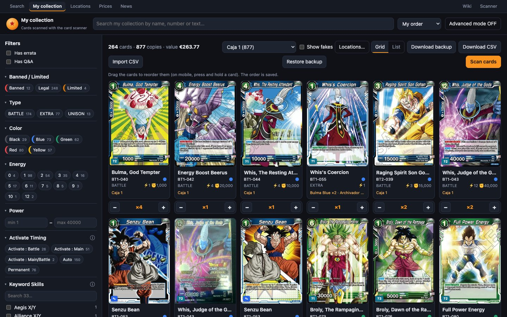
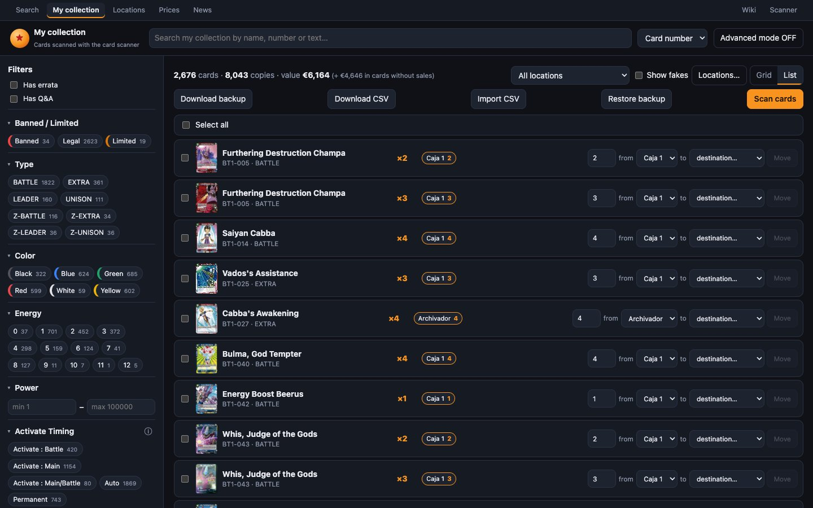

# Mi colección

**«My collection»** (`/collection`) es el buscador («Search»), pero solo con las cartas que tienes. Tiene la misma búsqueda, los mismos filtros, el mismo modo avanzado y la misma ficha. Además lleva todo lo necesario para gestionar tus copias: cuántas tienes, dónde están, cuáles son falsas y cuánto vale todo.

## Copias, cartas y ubicaciones

Tres ideas para entender esta parte:

- **Carta**: una impresión concreta (BT20-149 normal y BT20-149 alt-art son cartas distintas).
- **Copia**: cada ejemplar físico que tienes de una carta.
- **Ubicación**: dónde está cada copia. Puede ser un **mazo**, un **archivador**, una caja de **almacén** u **otro** sitio. Siempre existe **«Unsorted»** (sin ubicar), donde va lo que no tiene sitio todavía (lo escaneado sin destino, lo que sale de un mazo…). Más en [Ubicaciones](ubicaciones.md).

Cada copia es además **auténtica** o **falsa** (ver [Copias falsas](#copias-falsas)).

## La barra de resultados

Encima de las cartas:

- **«N cards · M copies»**: cuántas cartas distintas y cuántas copias cumplen la búsqueda actual. Por defecto solo cuentan las copias auténticas.
- **«value €X»**: lo que valen esas copias auténticas, con el precio de cada carta.
  - **«(+ €Y in cards without sales)»**: lo que suman las cartas que solo tienen un anuncio de un vendedor. Va aparte y no se suma al total.
  - Al pasar el ratón se ve el desglose, incluidas las copias que no tienen precio.

  Cómo se calcula cada precio: [De dónde sale cada precio](precios.md).
- **Selector de ubicación**: «All locations» o una concreta. Cada una lleva su número de copias, con las falsas incluidas.
- **«Show fakes»** (mostrar falsas): cuenta y muestra también las copias falsas.
- **«Locations…»**: va a la página de [Ubicaciones](ubicaciones.md).
- **Selector de vista**:
  - **«Grid»** (cuadrícula);
  - **«List»** (lista);
  - **«Deck»** (mazo), solo cuando la ubicación elegida es un mazo.
- **«Download backup»**, **«Download CSV»**, **«Import CSV»** y **«Restore backup»**: ver [Importar, exportar y copia](importar-exportar.md).
- **«Scan cards»**: abre el [Escáner](escaner.md).

> [!TIP]
> El valor y los contadores siguen tus filtros. Filtra por «Rarity: Secret Rare» y verás cuántas SCR tienes y cuánto valen. Elige una ubicación y verás lo que vale esa caja.

## Ordenar

Están las mismas opciones que en «Search», y dos más:
- **«Most copies»**: primero las cartas de las que más copias tienes.
- **«My order»**: solo con una ubicación elegida. Es el orden en que tú has colocado las cartas en esa ubicación (ver [Reordenar](#reordenar-arrastrando)). Al elegir una ubicación, el orden pasa a «My order» automáticamente.

## Vista «Grid»

Cada carta muestra lo mismo que en «Search» y además:
- **La ubicación** (o «Caja 1 ×2 · Archivador ×1» si hay copias en varias).
- **Con «Show fakes»:** el distintivo «N fakes».
- **Debajo:** los botones **− ×N +**.

### Añadir y quitar con − / +

- **Con una ubicación elegida**, **+** y **−** suman o quitan en esa ubicación.
- **Con «All locations»:**
  - **+** suma una copia auténtica en **«Unsorted»**.
  - **−** quita primero de «Unsorted». Si allí no hay, quita de la única otra ubicación donde esté la carta.
  - Si la carta está en **varias ubicaciones**, no adivina de cuál quitar: abre la ficha con el aviso «This card is in several locations: remove the copy from the one you want.»
- **Sin «Show fakes»**, **−** solo quita auténticas. Con «Show fakes», quita primero auténticas y después falsas.

Una carta que llega a 0 copias desaparece de la lista en el momento.

### Reordenar arrastrando

Con una ubicación elegida y el orden **«My order»**, puedes **arrastrar las cartas** para colocarlas como las tienes de verdad (útil en un archivador). El aviso lo recuerda: «Drag the cards to reorder them (on mobile, press and hold a card). The order is saved.»

- **En el ordenador:** pincha y arrastra.
- **En el móvil:** mantén pulsada la carta un momento y arrastra.
- **Las cartas nuevas** de una ubicación van al final.
- **Solo se reordenan las cartas que estás viendo.** Las de otras páginas o las que tienes filtradas mantienen su sitio.

## Vista «List»: mover copias

La lista sirve sobre todo para **mover copias entre ubicaciones**, una a una o muchas de golpe.

**Cada fila tiene:**
- la casilla de selección;
- la miniatura (al pulsarla se abre la ficha);
- el total **×N**;
- una etiqueta por ubicación con su cantidad. Las falsas llevan «fake», y la nota se ve al pasar el ratón.
- el control de mover: **[n] from [origen] to [destination…] → «Move»**.

El origen que se propone es la ubicación elegida, o si no la que más copias tiene. Las falsas aparecen como «Caja 1 (fakes)» y siguen siendo falsas al moverlas.

**Mover muchas a la vez:**
1. Marca las cartas, o usa **«Select all»** para las de la página.
2. Arriba aparece **«Move [all their copies | 1 copy] from [origen] to [choose destination…] → Move N»**.
3. Si alguna de las seleccionadas no tiene copias en el origen, el aviso del botón lo dice.
4. **«Clear selection»** desmarca todo.

> [!NOTE]
> **Las notas al mover:**
> - Si mueves **todas** las copias de una fila, la nota viaja con ellas.
> - Si mueves solo **algunas**, la nota se queda en el origen.
> - Desde la ficha puedes elegir **qué línea** de la nota se lleva la copia, por ejemplo la posición en el archivador.

## Vista «Deck»

Cuando eliges un mazo, la vista pasa a **«Deck»**: Leader, Main Deck, Z Deck y Side Deck, con sus reglas, estadísticas, versiones y partidas. Lo explicamos en [Mazos](mazos.md).

## Copias falsas

Las proxies o falsificaciones que tengas puedes apuntarlas como **falsas**, sin mezclarlas con las auténticas:

- **Cómo se marcan:** se marcan a mano desde la ficha, con **«Mark as fake»** en la fila de la ubicación. **«It's genuine»** hace lo contrario. Cada clic cambia **una** copia.
- **Cómo se guardan:** cada carta tiene en cada ubicación una fila de auténticas y otra de falsas, con su propia nota (p. ej. «AliExpress, junio»).
- **Cómo entran las nuevas:** las copias nuevas (+, escáner, importación sin columna `fake`) entran siempre como auténticas.
- **Por defecto no cuentan en nada:** ni en los contadores, ni en los filtros, ni en el valor. Para verlas marca **«Show fakes»**.
- **El valor de la colección nunca las incluye**, aunque estén a la vista.

> [!IMPORTANT]
> Una falsa en un mazo sigue contando en la **lista del mazo**, porque físicamente está ahí. Lo que no hace es sumar en el valor.

## Añadir cartas desde el Buscador

No hace falta ir a «My collection» para añadir una carta. En la ficha de cualquier carta de «Search» tienes el panel de tus copias con **«Add to My collection in» [ubicación] → «Add»**. Ver [La ficha de una carta](ficha-de-carta.md#tus-copias). En la rejilla de «Search», las cartas que tienes llevan **×N**.

## Colección vacía

Si todavía no tienes nada, la página dice «Your collection is empty: scan cards with the scanner and they'll show up here.» Hay tres formas de llenarla:
- el [Escáner](escaner.md);
- **«Add»** desde la ficha de una carta;
- [importar un CSV](importar-exportar.md).
