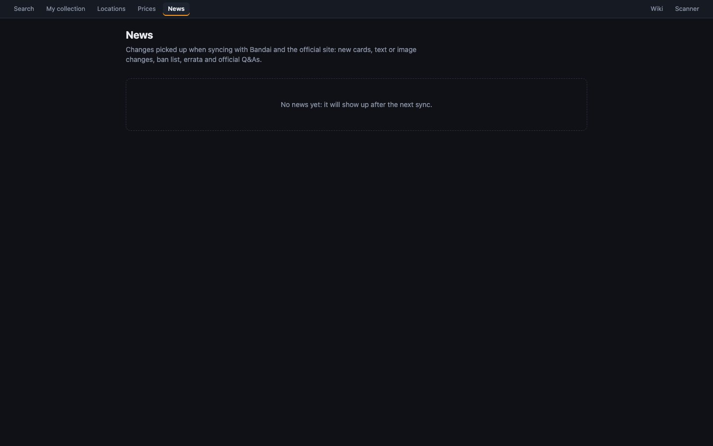

# Novedades

La página **«News»** (novedades, `/news`) lista todo lo que ha cambiado en el catálogo: cartas nuevas, cambios de texto o imagen, la ban list, erratas y preguntas oficiales nuevas. Sirve para enterarte de qué ha publicado Bandai sin revisar nada a mano.

## El aviso del menú

En el menú, junto a **«News»**, aparece un número naranja con los cambios **desde tu última visita** a esta página (hasta «99+»). Al entrar en la página desaparece.

> [!NOTE]
> «Tu última visita» se guarda **en este navegador**. En otro navegador o en el móvil la cuenta es independiente. Si nunca has entrado en «News» desde un navegador, ahí cuenta todo.

## Qué se apunta

| Tipo | Cuándo |
|---|---|
| **«New card»** | Aparece en Bandai una carta que no estaba. |
| **«Text change»** | Cambia el nombre o el texto, de cualquiera de las dos caras. |
| **«New image»** | Bandai cambia la imagen de la carta. |
| **«Attribute change»** | Cambian Energy, Color Cost, Power, Power de la cara trasera, Combo Energy, Combo Power o Z-Energy Cost. |
| **«Banned»** / **«Limited»** / **«Legal again»** | Cambia la ban list oficial. |
| **«Official errata»** | Bandai publica una errata. |
| **«New question (Q&A)»** | Aparece una pregunta oficial nueva sobre la carta. |

La primera vez que se importa algo (el catálogo entero, la ban list…) **no** se apunta como novedad; si no, saldrían miles de cambios falsos. Las preguntas se comparan por su texto, porque la web oficial cambia su numeración a menudo.

## Cómo se ve

- **Orden:** los cambios están agrupados **por día**, del más reciente al más antiguo, con **60 por página**.
- **Cada cambio muestra:**
  - la miniatura de la carta (al pulsarla se abre su [ficha](ficha-de-carta.md));
  - el tipo de cambio;
  - la etiqueta **«new»** si es posterior a tu última visita;
  - el número y el nombre.
- **El detalle depende del tipo:**
  - **«New card»:** «New in the catalogue.»
  - **Texto y errata:** dos columnas, **«Before»** y **«After»**.
  - **Pregunta:** la pregunta → la respuesta.
  - **Resto:** «antes → **después**», por ejemplo «power: 10000 → **15000**».

## Filtrar

Arriba hay un botón por cada tipo, con cuántos cambios tiene. Puedes marcar varios (se combinan con O). **«show all»** quita el filtro.

> [!NOTE]
> - Los números de los botones son del total; no cambian al filtrar.
> - El filtro no se guarda en la dirección: al recargar la página vuelve a «show all».

## Cuándo se buscan cambios

Los cambios llegan con las sincronizaciones automáticas (hora de Madrid):

| Qué | Cuándo |
|---|---|
| Cartas nuevas | Todos los días a las 04:00 |
| Revisión completa del catálogo (texto, imagen, atributos) | Domingos a las 05:00 |
| Ban list | Todos los días a las 03:30 |
| Keyword skills, erratas y Q&A | Lunes a las 03:45, 03:50 y 03:55 |

Más detalle en [Datos y sincronización](datos-y-sincronizacion.md).
