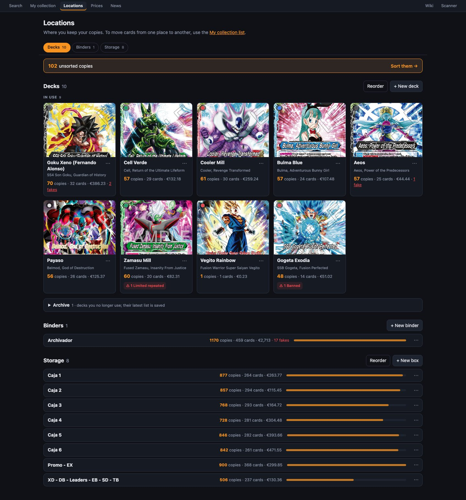

# Ubicaciones

Una **ubicación** es un sitio donde guardas cartas: un mazo, un archivador, una caja… La página **«Locations»** (ubicaciones, `/locations`) las lista todas con sus copias y su valor, y desde ella se crean, se editan, se ordenan y se mandan mazos al histórico.

## Tipos de ubicación

| Tipo | Para qué | En la página |
|---|---|---|
| **«Deck»** | Un mazo montado. Tiene Leader, versiones, side deck y partidas: ver [Mazos](mazos.md). | Pestaña «Decks» |
| **«Binder»** | Carpetas con fundas de 9. | Pestaña «Binders» |
| **«Storage»** | Cajas de cartas sueltas. | Pestaña «Storage» |
| **«Other»** | Cualquier otra cosa. | Pestaña «Other», solo si hay alguna |

Además está **«Unsorted»** (sin ubicar): siempre existe y **no se puede borrar**. Es donde caen:
- las cartas escaneadas sin destino;
- las añadidas con **+** sin elegir ubicación;
- las de un mazo que pasa al histórico;
- las de una ubicación que se borra.

Si «Unsorted» tiene copias, arriba de la página aparece **«N unsorted copies · Sort them →»**, que te lleva a ellas para repartirlas.

> [!NOTE]
> Esta página no mueve cartas. Para moverlas usa la [vista «List» de «My collection»](mi-coleccion.md#vista-list-mover-copias) (el enlace está en el texto de la cabecera).

## Las pestañas

Arriba están **«Decks»**, **«Binders»**, **«Storage»** y **«Other»**, cada una con su número. Al bajar por la página, la pestaña activa cambia sola según la sección que estás viendo.

### Mazos

**«In use N» (en uso):** una tarjeta por mazo con:
- el **arte de su Leader** (su cara Awaken) y los puntos de color;
- el nombre del mazo y el de su Leader;
- **«N copies · M cards · €X»**: el valor sale de Cardmarket y no cuenta las falsas;
- **«N fakes»**, que lleva al mazo mostrando también las falsas;
- **«⚠ N Banned · M Limited repeated»**, si hay cartas que no se pueden jugar. Al pasar el ratón se ven los números.

**Cómo se elige el Leader:** es la carta LEADER que hay en la caja. Si hay varias, la auténtica de la que tienes más copias. Si la caja está vacía, se usa el Leader de su última lista guardada.

**«Archive N»** (histórico, desplegable): los mazos que ya no juegas, «decks you no longer use; their latest list is saved». Cada uno muestra:
- cuántas copias quedan en la caja, o cuántas cartas tenía su última lista;
- desde cuándo está en el histórico, y «N times» si ya ha pasado varias veces;
- el botón **«Use again»**.

### Archivadores, Almacén y Otras

Una fila por ubicación con:
- su nombre y sus notas;
- **«N copies · M cards · €X»** y «N fakes»;
- una barra que compara su tamaño con el resto.

Al pulsarla se abre esa ubicación en «My collection».

## Crear una ubicación

Cada sección tiene su botón: **«+ New deck»**, **«+ New binder»**, **«+ New box»** o **«+ New location»**. Escribe el nombre (único, hasta 80 caracteres) y pulsa **«Create»**.

## Ordenar las ubicaciones

Con más de una ubicación en una sección aparece el botón **«Reorder»** (ordenar):
1. Arrastra cada fila por su asa **⠿**. En el móvil, mantenla pulsada un momento antes de arrastrar.
2. Pulsa **«Done»** para terminar.

Este orden es el que se usa en todos los selectores de ubicación de la web.

## El menú ⋯ de cada ubicación

### Editar…

El diálogo **«Edit location»** (opción «Edit…» del menú) permite cambiar:
- el nombre (**«Name»**);
- el tipo (**«Type»**: Deck, Binder, Storage, Other);
- las notas (**«Notes»**), por ejemplo «caja azul del armario».

**«Delete…»** pide confirmación: «Delete “Caja 3”? Its N copies will move to “Unsorted”.» Los escaneos que apuntaban a esa ubicación también pasan a «Unsorted».

> [!WARNING]
> - Un mazo con **partidas anotadas** no se puede borrar. Borra antes sus partidas o cámbiale el tipo.
> - El estado «en uso / en el histórico» no se cambia editando: se cambia con las opciones de abajo.

### Mover al histórico (solo mazos)

Cuando desmontas un mazo:

1. Se abre **«Move “Nombre” to the archive»** con la lista de lo que hay en la caja, marcando el Leader y las falsas.
2. Pulsa **«Move to archive»** (mover al histórico). Entonces:
   - si la caja tenía cartas, su lista se guarda como versión automática **«When moved to archive»**;
   - todas las copias, auténticas y falsas, pasan a **«Unsorted»**;
   - el side deck se vacía;
   - el mazo pasa al histórico y queda apuntado en su registro.
3. Al terminar puedes **«Copy list»**, que copia el texto `2x BT1-001 Nombre`, para saber qué cartas guardar, o ir a **«View “Unsorted”»**.

### Volver a usar (solo mazos del histórico)

El mazo vuelve a **«In use»** y la web **trae una copia de su Leader** a la caja, buscándola por este orden:
1. Primero auténticas.
2. Primero de «Unsorted», luego de archivadores y cajas, y como último recurso de otros mazos.

El aviso te dice de dónde la ha sacado; el resto de cartas las recuperas restaurando su última versión. Si no tienes ninguna copia del Leader, el aviso lo dice. **«Open the deck»** te lleva directamente.

### Registro de uso…

En los mazos que han pasado alguna vez por el histórico verás un registro («Usage log…») con:
- cuántas veces ha pasado al histórico y si ahora está en uso o en el histórico;
- cada entrada con fecha y hora: **«To the archive»**, con cuántas copias salieron, o **«Back in use»**.
