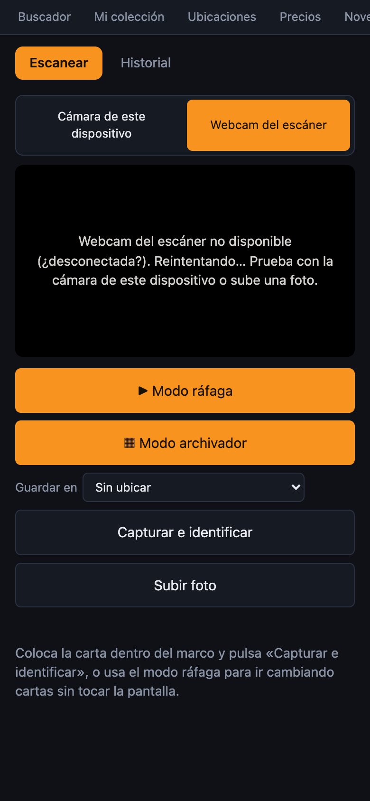
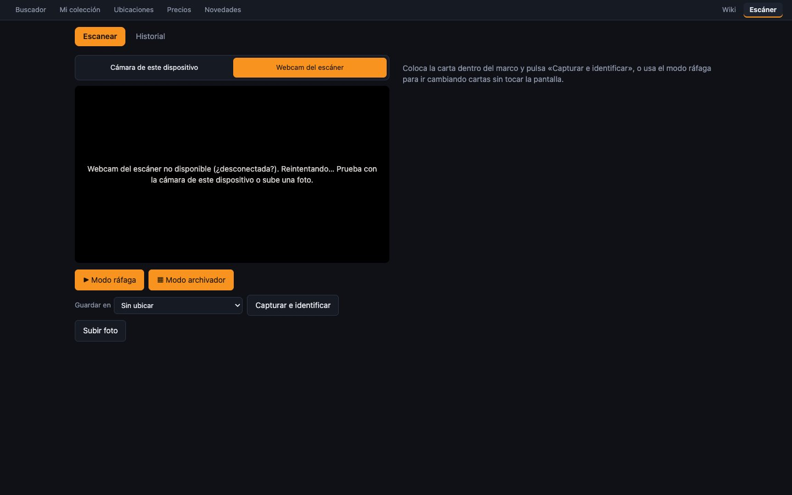

# Usar el escáner

El **Escáner** (`/scan`) reconoce cartas con una cámara y las añade a tu colección. Funciona con:
- la **cámara del móvil**;
- la **webcam USB** conectada al servidor;
- una **foto** que subas.

Tiene tres modos:
- **carta a carta**;
- **ráfaga**, para ir cambiando cartas sin tocar la pantalla;
- **archivador**, para escanear un archivador casilla por casilla.

## Antes de empezar: la cámara del móvil necesita HTTPS

Los navegadores solo dejan usar la cámara en directo en páginas seguras (**HTTPS**). En casa, la web va por HTTP, así que:

- **Si entras por HTTP**, el escáner dice «El navegador solo permite la cámara en directo con HTTPS.» y ofrece **«Abrir la versión segura»**.
- **La versión segura** usa un certificado propio de la red local, que hay que **instalar una vez en cada móvil**:
  1. Desde el móvil, abre `http://192.168.1.50/ca.crt` y descárgalo.
  2. **iPhone:** Ajustes → *Perfil descargado* → Instalar. Después, Ajustes → General → Información → **Confianza de certificados** → actívalo.
  3. **Android:** Ajustes → Seguridad → Instalar certificado (CA).
- **Si denegaste el permiso de la cámara:** en el iPhone, Ajustes → Chrome (o Safari) → Cámara → Permitir, y recarga la página.

Si nada de esto funciona, siempre te queda **«Subir foto»**.

> [!NOTE]
> El certificado se crea con `scripts/local-https.sh <ip>` en el servidor. Ver [Desarrollo y despliegue](despliegue.md).

## Elegir la cámara

- **Cámara de este dispositivo**: la del móvil (la trasera) o la del portátil.
- **Webcam del escáner**: una webcam USB conectada al servidor. La imagen llega con medio segundo de retraso. Si está desconectada, dice «Webcam del escáner no disponible (¿desconectada?). Reintentando…».

La web elige sola la del dispositivo en móviles y tabletas, y la del servidor en el resto, pero se puede cambiar. La elección se recuerda.

**Durante el escaneo:**
- La pantalla **no se apaga**, aunque dejes el móvil quieto en un soporte.
- Siempre se ve un **marco** con la forma de una carta (63 × 88 mm). Pon la carta dentro.
- En ráfaga y archivador solo se envía lo que hay dentro del marco.

## Modo carta a carta

1. Coloca la carta dentro del marco.
2. Pulsa **«Capturar e identificar»** (o **«Subir foto»**).
3. Mientras trabaja muestra «Identificando…». Al terminar sale el **resultado**:
   - **«Identificada · 92%»**: la ha reconocido con esa confianza;
   - **«No estoy seguro · 38%»**: tienes que revisarla (ver [Revisar escaneos dudosos](revisar-escaneos.md));
   - debajo, tu foto recortada al lado de la ficha de la carta reconocida.
4. Si es correcta, pulsa **«Añadir a la colección»**: suma 1 copia auténtica a **«Sin ubicar»**. Si no lo es, **«¿No es esta carta? Corregir»**.

> [!NOTE]
> En el modo carta a carta **no se añade nada solo**: decides tú cada vez. Para añadir en masa usa la ráfaga.

## Modo ráfaga

Es el modo para dar de alta muchas cartas seguidas: **pones una carta, la reconoce, la añade y pones la siguiente**, sin tocar la pantalla.

1. Elige **«Guardar en»**: la ubicación donde irán las cartas, o «Sin ubicar». Se recuerda para la próxima vez.
2. Pulsa **«▶ Modo ráfaga»** con la zona del marco **vacía**: durante un segundo aprende cómo es el fondo.
3. Ve poniendo cartas de una en una. Arriba se ve lo que hace en cada momento:
   - **«Esperando carta…»**;
   - **«Movimiento: deja la carta quieta»**;
   - **«Carta quieta…»**;
   - **«Enviando…»**.

   Una carta nueva se captura sola cuando lleva 0,7 segundos quieta y es distinta de la anterior.
4. Cada captura aparece en el **panel de la sesión**, con sonido:
   - **Añadida** (dos tonos ascendentes): la ha reconocido con **65 % o más** y ha sumado 1 copia en la ubicación elegida.
   - **Por revisar** (un tono grave): no está segura. Pulsa **«Revisar»** y elige la carta buena.
   - **¿Otra copia?**: has puesto la misma carta otra vez sin quitar la anterior. No suma hasta que lo digas: elige cuántas con **− / +** y pulsa **«Añadir N copias»**.
5. Pulsa **«■ Terminar sesión»** al acabar.

**El panel de la sesión:**
- Arriba los contadores: **añadidas**, **por revisar** y **deshechas**.
- Cada fila muestra la miniatura, el número y el nombre, la confianza y el tiempo que tardó.
- **Cambiar cuántas copias:** usa **− [n] +** en las añadidas. **PS** pone 4 de golpe (un playset).
- **Corrección:**
  - **«Corregir»**: elige otra carta. Quita la copia mal añadida y suma la buena.
  - **«Deshacer»**: quita la copia que se añadió.
  - **«Descartar»**: ignora una captura por revisar.
- **«Capturar ahora»** fuerza una captura sin esperar al detector.

> [!TIP]
> **Para que la ráfaga vaya fina:**
> - Usa un **fondo liso y oscuro**, con luz uniforme y sin reflejos.
> - Retira la carta y pon la siguiente con un movimiento limpio. Si el móvil se mueve, el detector tiene que volver a estabilizarse.
> - Si empiezas con una carta ya puesta, esa primera no se captura sola: usa «Capturar ahora».

## Modo archivador

Para escanear un archivador **casilla a casilla**, con su página y posición apuntadas:

1. Elige el destino en **«Guardar en»**, normalmente el propio archivador.
2. Pulsa **«▦ Modo archivador»**. Aparece una rejilla de 3 × 3 y **«‹ Página N ›»**.
3. La web te dice qué casilla toca: «Acerca la cámara a la carta de la **fila 1, columna 1** hasta que llene el marco».
4. Pulsa **«Capturar casilla N»**. Si la funda está vacía, pulsa **«Hueco vacío»**.
5. Al acabar las 9, pulsa **«Página siguiente →»**.
6. Pulsa **«■ Terminar»** al acabar.

Cada copia añadida guarda su posición en la **nota**, por ejemplo «**Pág. 12 · fila 2 · col 3**». Así siempre sabrás dónde está cada carta en el archivador.

- **Repetir una casilla:** pulsa la casilla en la rejilla. La captura nueva sustituye a la anterior.
- **Qué se añade solo:** lo mismo que en la ráfaga (65 % o más). El resto queda por revisar.

## La pestaña «Historial»

Junto a «Escanear» está **«Historial»**: todos los escaneos, 30 por página, con:
- **Fecha**;
- **Origen**: «Cámara» o «Foto subida»;
- **Resultado**;
- **Confianza**;
- **Tiempo**.

Las filas pendientes de revisar se ven resaltadas. Al pulsar una fila se abre su resultado.

> [!NOTE]
> **Las fotos se borran** a las 24 horas, o antes si ocupan más de 2 GB. El escaneo se queda en el historial, pero sin foto ya no se puede confirmar ni corregir. Ver [Cómo reconoce las cartas](como-reconoce.md#fotos).

## Si sale una versión nueva de la web

En sesiones largas, si se despliega una versión nueva, arriba aparece «Hay una versión nueva de la web.» con el botón **«Recargar»**.
