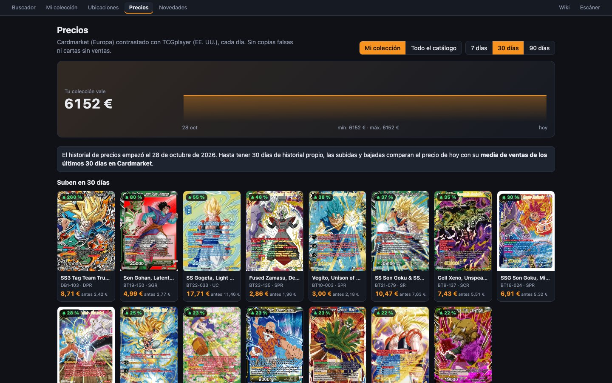

# La página «Precios»

La página **Precios** (`/prices`) resume el dinero:
- cuánto vale tu colección y cómo evoluciona;
- qué cartas suben y bajan;
- cuáles son las más caras.

Debajo del título: «Cardmarket (Europa) contrastado con TCGplayer (EE. UU.), cada día. Sin copias falsas ni cartas sin ventas.»

## Los controles

- **Mi colección** / **Todo el catálogo**: qué cartas se miran. Por defecto, solo las tuyas (con al menos una copia auténtica).
- **7 días** / **30 días** / **90 días**: el periodo de las subidas y bajadas. Por defecto, 30 días.

## El valor de tu colección

Con «Mi colección» elegido, arriba sale:
- **«Tu colección vale X €»**;
- la variación en el periodo (**▲ / ▼ N % en N días**);
- una **gráfica** de la evolución, con la fecha de inicio, el mínimo y el máximo.

Para que la gráfica cuente cómo cambian los **precios** y no cuántas cartas has ido metiendo, se calcula con **las copias que tienes hoy** multiplicadas por el precio de cada día. Solo cuentan las copias auténticas y los precios que cuentan en el valor (con ventas o a mano).

Con menos de dos días de historial dice «La gráfica aparecerá cuando haya varios días de historial.»

## Suben, bajan y las más caras

Tres bloques de hasta 15 cartas:

| Bloque | Qué muestra |
|---|---|
| **Suben en N días** | Las que más han subido en porcentaje. |
| **Bajan en N días** | Las que más han bajado. |
| **Las más caras de tu colección** (o **Las más caras**) | Por precio actual. |

**Cada tarjeta muestra:**
- la imagen;
- la variación **▲ / ▼ N %**;
- el nombre, el número y la rareza;
- el precio actual y el de antes.

Al pulsarla se abre su [ficha](ficha-de-carta.md).

**Para que salga en suben o bajan**, una carta tiene que:
- tener un precio que cuente en el valor;
- valer al menos **1 €**, antes o ahora, para no llenar la lista de cartas de céntimos.

## Mientras no haya historial suficiente

El historial propio empezó el **28 de octubre de 2026**. Mientras no tenga tantos días como el periodo elegido, las subidas y bajadas se calculan de otra forma. Arriba lo avisa:

> El historial de precios empezó el 28 oct. Hasta tener N días de historial propio, las subidas y bajadas comparan el precio de hoy con su **media de ventas de los últimos 7 / 30 días en Cardmarket**.

En ese modo:
- el periodo de 7 días compara con la media de 7 días, y los de 30 y 90 días con la de 30;
- solo entran cartas con precio de Cardmarket;
- se ignoran los saltos de más de 5 veces, que suelen ser una venta suelta y no un cambio de precio real.

Cuando el historial sea lo bastante largo, la página usará el suyo propio sin que tengas que hacer nada.
