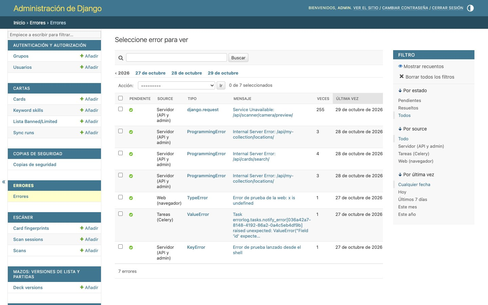

# Registro de errores

Cuando algo falla, sea en el servidor, en una tarea de fondo o en tu navegador, queda apuntado en el admin, en **Errores** (`/admin/errorlog/errorgroup/`). Si el error es nuevo, además llega un aviso por Telegram.

## De dónde llegan

| Origen | Qué recoge |
|---|---|
| **Servidor (API y admin)** | Cualquier error del backend: fallos 500 de la API o del admin (con el método, la dirección y el navegador) y errores registrados por el código. |
| **Tareas (Celery)** | Errores de las tareas en segundo plano: sincronizaciones, precios, escáner… |
| **Web (navegador)** | Errores de JavaScript en tu navegador mientras usas la web. Solo en la versión del servidor, no en desarrollo. |

En el navegador:
- se envían como mucho 10 errores distintos por página;
- se ignora el ruido de las extensiones del navegador.

El envío es silencioso: no ves nada en pantalla.

## Agrupados por causa

Los errores **no se apuntan uno a uno**: se agrupan por **tipo + sitio del código**. Si el mismo fallo pasa 200 veces, ves una sola fila con:
- **veces**: cuántas ha pasado;
- **primera vez** y **última vez**;
- el último **mensaje**, la **traza**, la **petición** y el **navegador**.

El mensaje no cuenta para agrupar, porque suele cambiar con los datos.

## La página

- **Filtro «estado»:** **Pendientes** (por defecto), **Resueltos** o **Todos**. También se puede filtrar por origen y por fecha.
- **Columnas:** si está pendiente, el origen, el tipo, el mensaje (primera línea), las veces, la última y la primera vez.
- **Acciones:** selecciona errores y aplica una de estas dos:
  - **«Marcar como resueltos»**: cuando ya está arreglado. Si vuelve a pasar, **se reabre solo**.
  - **«Reabrir»**.
- **Solo lectura:** no se pueden crear ni editar errores a mano.

## Avisos por Telegram

Llega un aviso (silencioso, sin sonido) en dos casos:
- **🐞 Error nuevo**: una causa que no se había visto antes;
- **🐞 Vuelve un error resuelto**: lo marcaste como resuelto y ha vuelto a pasar.

El aviso lleva el enlace directo al error en el admin. Si el mismo error se repite, **no llegan más avisos**: solo sube su contador.

## Limpieza

Cada día a las 05:30 se borran los errores **resueltos hace más de 90 días**. Los pendientes no se borran nunca solos.
