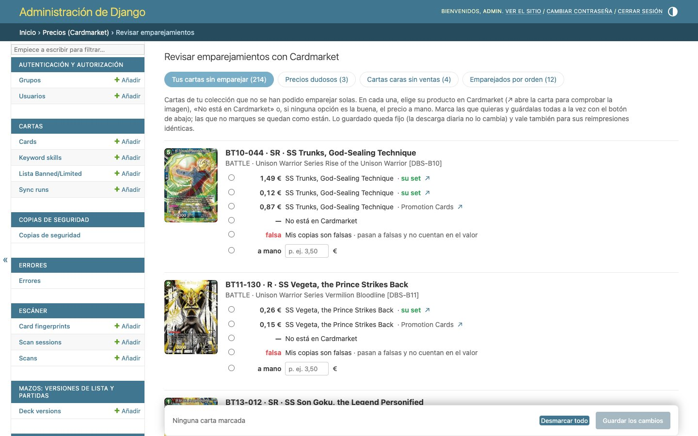

# Revisar precios en el admin

El emparejamiento automático con Cardmarket acierta casi siempre, pero hay casos que no puede decidir solo: promos, cartas que Cardmarket nombra distinto, varias impresiones con el mismo nombre… Esos casos van a una página de revisión en el admin:

**`/admin/prices/pricereview/`** (en el admin: *Precios (Cardmarket) → revisar emparejamientos*)

> [!NOTE]
> La revisión **solo incluye cartas de las que tienes copias auténticas**: son las que afectan al valor de tu colección.

## Las pestañas

| Pestaña | Qué hay |
|---|---|
| **Tus cartas sin emparejar** | Cartas sin producto de Cardmarket: no se encontró ninguno o había varios y no se pudo decidir. |
| **Precios dudosos** | Cartas con un solo anuncio desproporcionado para su rareza (ver [precios sospechosos](precios.md#precios-sospechosos)). No cuentan en el valor hasta que las revises. |
| **Cartas caras sin ventas** | Cartas de 10 € o más que solo tienen un anuncio, sin ventas. Muchas veces la carta está bien emparejada y simplemente es rara; otras, tu copia es otra edición. |
| **Emparejados por orden** | Grupos de impresiones con el mismo nombre en un set, emparejadas por orden de rareza, donde algo no cuadra (una rareza alta sale más barata que una baja), y cartas emparejadas con «la más barata de varias». |

Cada pestaña muestra cuántas cartas tiene. Las cartas van de 25 en 25, ordenadas por set y número.

## Qué puedes elegir para cada carta

En las tres primeras pestañas, cada carta muestra su imagen, número, rareza y set, y estas opciones:

| Opción | Qué hace |
|---|---|
| **Un producto candidato** | Los productos de Cardmarket que podrían ser esta carta, con su precio, su nombre, «su set» o la expansión, y ↗ para abrirlo en Cardmarket. «· precio actual» marca el que tiene ahora. |
| **No está en Cardmarket** | La carta no tiene producto. Se queda sin precio de Cardmarket (si tiene TCGplayer, se usa ese). |
| **a mano: [ ] €** | Pon tú el precio, con coma decimal, por ejemplo `3,50`. Al escribir en la casilla, la opción se marca sola. |
| **Mis copias son falsas** | Tus copias pasan a [falsas](mi-coleccion.md#copias-falsas) y dejan de contar en el valor. |
| **Tengo otra edición:** (en «caras sin ventas») | Muestra las otras impresiones del mismo número con su precio. Al elegir una, **tus copias pasan a esa impresión**, en la misma ubicación y con sus notas y su marca de falsa. Es para cuando el escáner o la importación apuntaron a la edición equivocada. |

> [!TIP]
> Antes de elegir, abre el candidato con **↗**: en Cardmarket verás la foto y podrás comprobar que es tu edición (sello de torneo, foil, idioma…).

## Guardar

Abajo hay una **barra fija** con **«Desmarcar todo»** y **«Guardar los cambios (N)»**. Puedes marcar muchas cartas y guardarlas de una vez. Si intentas salir con cambios sin guardar, la página avisa.

**Al guardar:**
- Tus elecciones **quedan fijas**: la actualización diaria no las cambia.
- Se aplican también a las **reimpresiones idénticas**: mismo número, rareza y set.
- El precio de esas cartas **se recalcula al momento**.
- Arriba aparece un resumen: «Guardadas N cartas (y sus reimpresiones idénticas): …».

## La pestaña «Emparejados por orden»

Aquí no se va carta a carta, sino **por grupos**: las impresiones de un mismo nombre en un set (normal, alt-art, SPR…). Para cada impresión hay un desplegable con los productos de ese nombre en la expansión.

- **«Están bien así»**: confirma el grupo tal cual. Pasa a «elegido a mano» y no vuelve a salir.
- **«Guardar cambios»**: guarda lo que hayas cambiado en los desplegables.

## Cómo se emparejó cada carta

En el admin, *enlaces con Cardmarket* muestra el **método** de cada carta:

| Método | Significado |
|---|---|
| Automático (única) | Solo había un producto con ese nombre en su set. |
| Automático (por orden) | Varias impresiones con el mismo nombre: se ordenaron por rareza y precio. |
| Automático (como su versión normal) | Reimpresión: copia el producto de la impresión original. |
| Automático (la más barata de varias) | Varios productos posibles: se tomó el más barato con ventas. |
| Elegido a mano | Lo elegiste tú en la revisión. |
| No está en Cardmarket | Lo marcaste tú. |
| Precio puesto a mano | Pusiste el precio tú. |

Los tres últimos son **manuales** y la actualización diaria los respeta siempre.

## Cada cuánto revisar

No hace falta entrar a diario. Revisa la página:
- cuando salga un **set nuevo** y lo hayas escaneado;
- cuando un precio de tu colección te parezca raro;
- de vez en cuando, para ver si hay **precios dudosos** nuevos.
